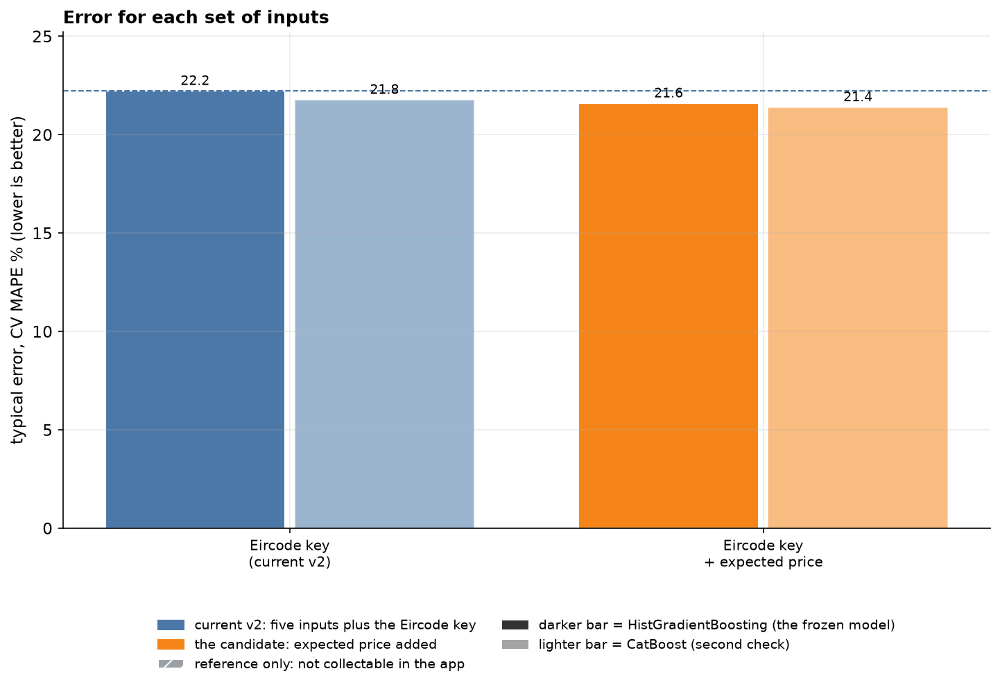
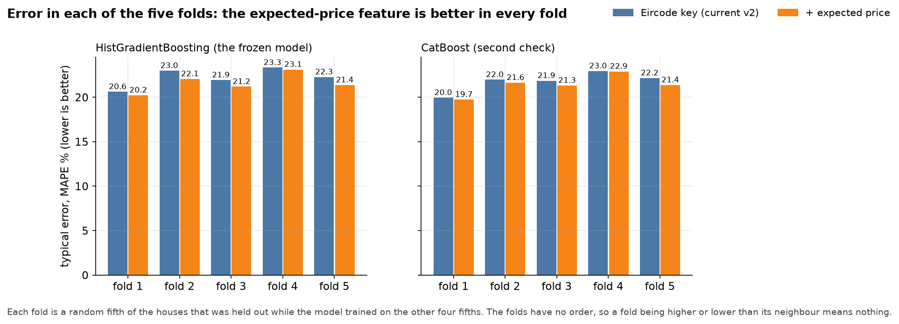
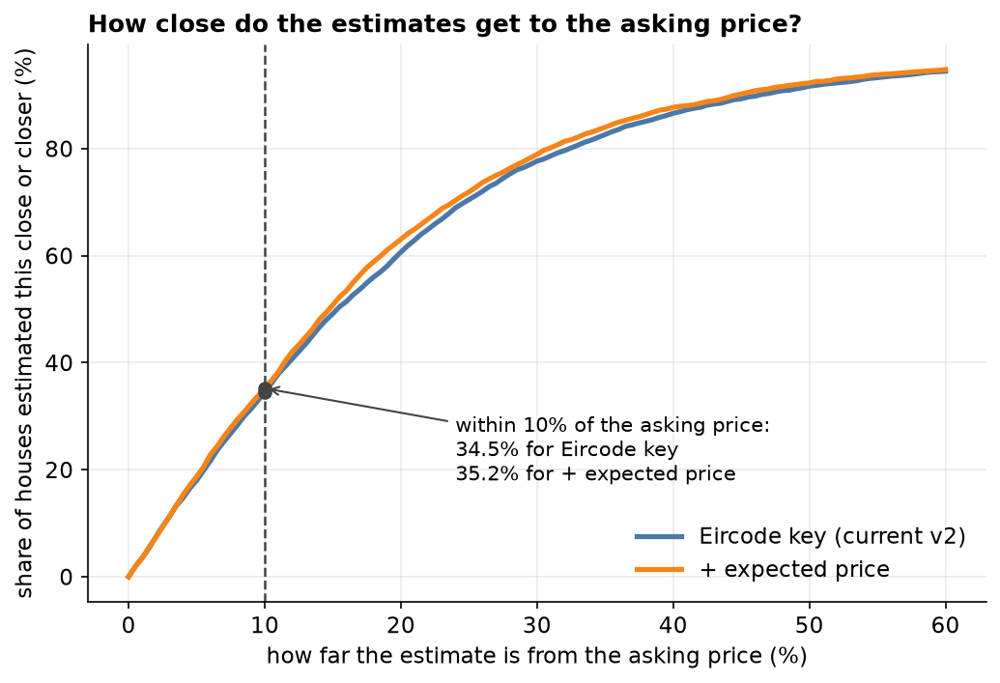
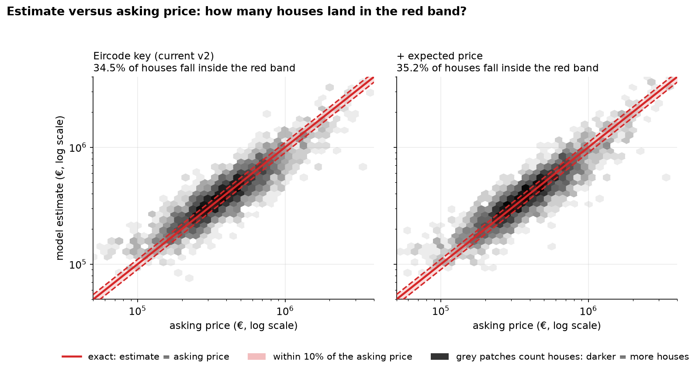
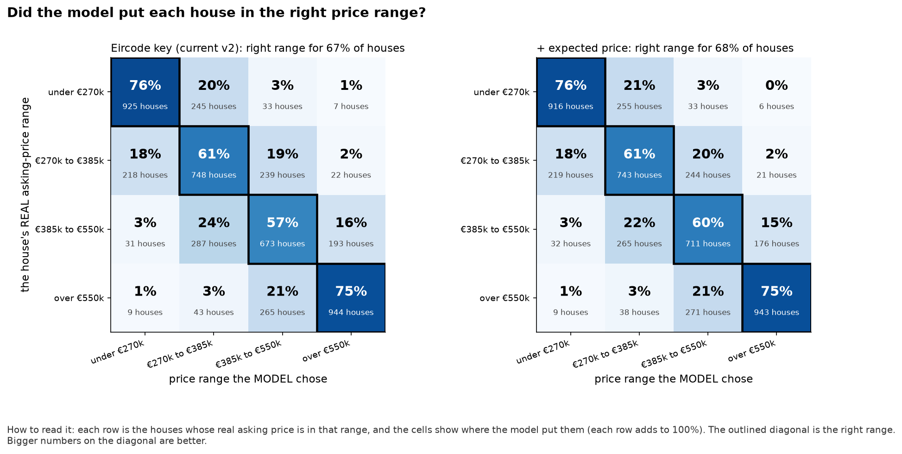
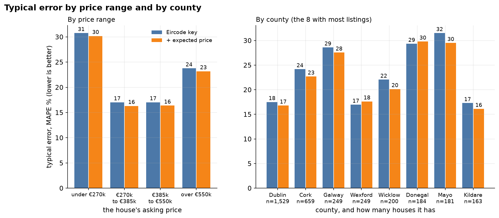
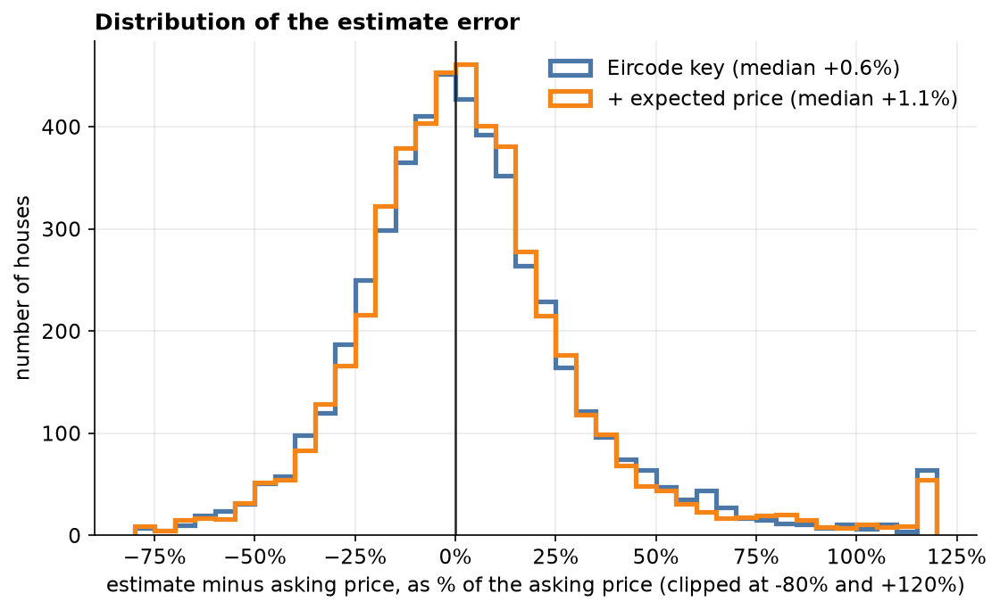

# Follow-up: does an expected-price feature help beyond the Eircode key?

An exploratory follow-up added after the four research agents reported, with its rules and leakage checks committed first (`followup_config.json`). Development split only (4,882 rows, the same five group folds). Calibration and the final test were not read, and the frozen model is unchanged.

## What the feature is

`expected price = log(area) + the routing key's smoothed average of log(price per m²)`. It is a lookup table learned from training rows, plus the house's own area. Nothing new is asked in the app.

## Is it leakage? How it was checked

A target-style feature leaks if a house's own asking price (or its repeat advert's) feeds into its own feature, or if the scored rows' prices reach their own prediction. It is built to avoid both:

- **Training rows** get an out-of-fold value: the table is learned from training rows outside the row's own inner fold, and inner folds are whole property groups.
- **Scored rows** get the table learned from the training folds only. Their prices are never used.

Checks (tests in `tests/test_followup.py`):

- A training row's feature does not change when every price in its own inner fold changes, including its own and its repeat advert's.
- A repeat advert's price does not reach its sibling.
- Without the property-group column the builder refuses to run instead of leaking.
- I planted two leaks on purpose (training rows using the full table; inner folds split by row instead of by property group) and the tests failed for both.

**Canary on the real development rows.** If the feature leaked the scored rows' prices, it would still look good after the prices are shuffled across houses. A leak-free feature has nothing to learn from shuffled prices:

| Shuffle seed | Eircode key (CV MAPE %) | + expected price (CV MAPE %) | Gain |
|---|---|---|---|
| 1 | 58.22 | 58.66 | -0.44 |
| 2 | 57.38 | 57.67 | -0.29 |
| 3 | 57.03 | 57.64 | -0.60 |

On shuffled prices the average gain is -0.44 points, which is noise. The gain on the real prices is 0.63, so it is not coming from a leak.

## Results

| Model | Inputs | CV MAPE % | MdAPE % | Within 10% | Average miss (MAE) | R² | Median over/under | Mean estimate ÷ mean asking |
|---|---|---|---|---|---|---|---|---|
| HistGradientBoosting (frozen model's settings) | Eircode key (current v2) | 22.23 | 15.36 | 34.5 | €115,807 | 0.683 | +0.6% | 0.949 |
| HistGradientBoosting (frozen model's settings) | + expected price | 21.60 | 14.79 | 35.2 | €112,483 | 0.695 | +1.1% | 0.960 |
| CatBoost (second check) | Eircode key (current v2) | 21.78 | 14.91 | 35.9 | €112,540 | 0.694 | +0.4% | 0.938 |
| CatBoost (second check) | + expected price | 21.40 | 14.49 | 37.1 | €110,607 | 0.697 | +0.7% | 0.951 |

Fold by fold (CV MAPE %, current → with expected price):

| Model | fold 1 | fold 2 | fold 3 | fold 4 | fold 5 |
|---|---|---|---|---|---|
| hist_gradient_boosting | 20.6 → 20.2 | 23.0 → 22.1 | 21.9 → 21.2 | 23.3 → 23.1 | 22.3 → 21.4 |
| catboost | 20.0 → 19.7 | 22.0 → 21.6 | 21.9 → 21.3 | 23.0 → 22.9 | 22.2 → 21.4 |

## Verdict by the rule fixed beforehand

**Not adopted by the rule.** The gain is 0.63 points (HistGradientBoosting, 5/5 folds) and 0.38 (CatBoost, 5/5 folds), and the rule fixed beforehand needs at least 1.0 point in both models and all five folds.

## Pictures

Blue is the current v2 (five inputs plus the Eircode key), orange adds the expected-price feature. Out-of-fold predictions on the development split throughout.

### 1. Error: current v2 against the candidate

Eircode key + expected price moves CV MAPE from 22.23% to 21.60% (HistGradientBoosting) and from 21.78% to 21.40% (CatBoost). Orange is the proposed input, blue the other app-collectable inputs, and hatched grey the reference-only ones (town and coordinates), which show how much more there is to gain.

### 2. Error in each of the five folds

The expected-price feature lowers the error in all five folds for both models. The smallest single-fold gain is 0.04 points, so this is not one lucky fold.

### 3. How close do the estimates get?

Within 10% of the asking price: 34.5% to 35.2%. Within 20%: 60.7% to 63.1%. Within 30%: 77.7% to 78.9%.

### 4. Estimate versus asking price

Each grey patch counts houses (darker is more). A perfect model would put every house on the red line, and the shaded band is within 10%. The share inside the band is in each panel title.

### 5. Did the model pick the right price range? (confusion matrix)

This is the regression version of a confusion matrix: houses are split into four price ranges (under €270k, €270k to €385k, €385k to €550k, over €550k), cut at the quartiles of the development prices, and each row shows where the model placed them. Right range: 67.4% to 67.9%. Right range or the one next to it: 97.0% to 97.2%.

### 6. Typical error by price range and county

The error is lower in 4 of 4 price ranges and in 6 of the 8 biggest counties. The biggest county gain is Mayo (31.5% to 29.5%).

### 7. Distribution of the error

The median error is +0.6% with Eircode key and +1.1% with the expected-price feature (0% means no systematic over- or under-estimate). The spread of errors (standard deviation) goes from 30 to 29 percentage points. Some very large misses remain.
