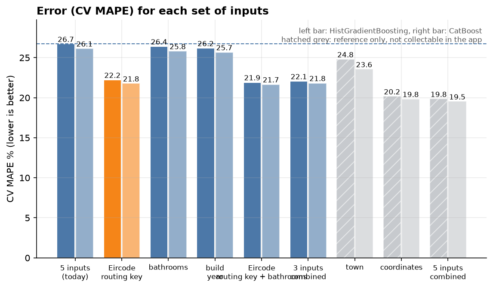
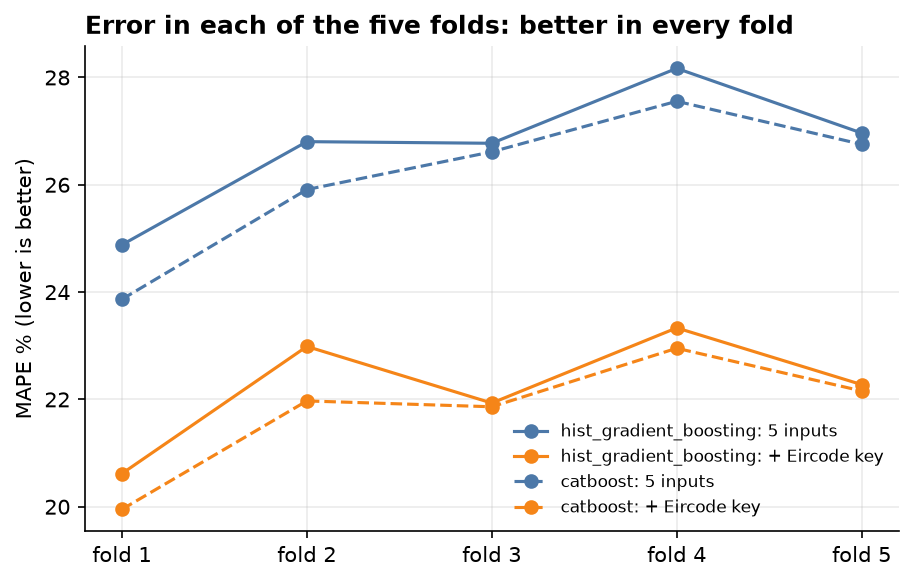
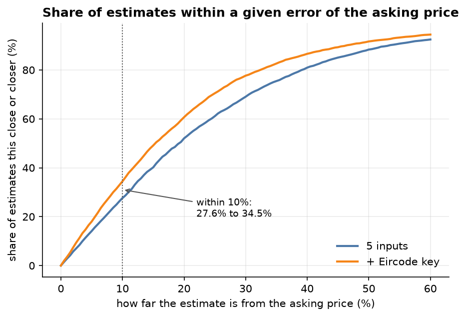
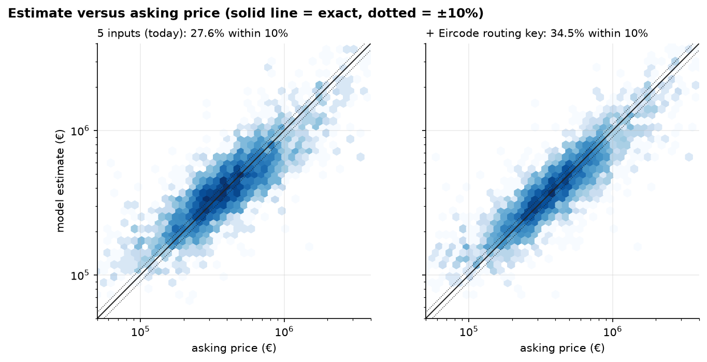
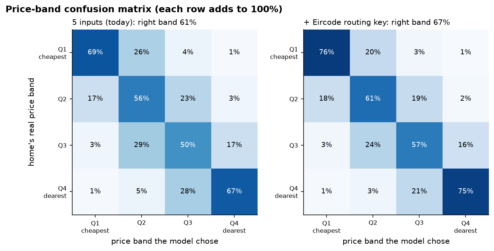
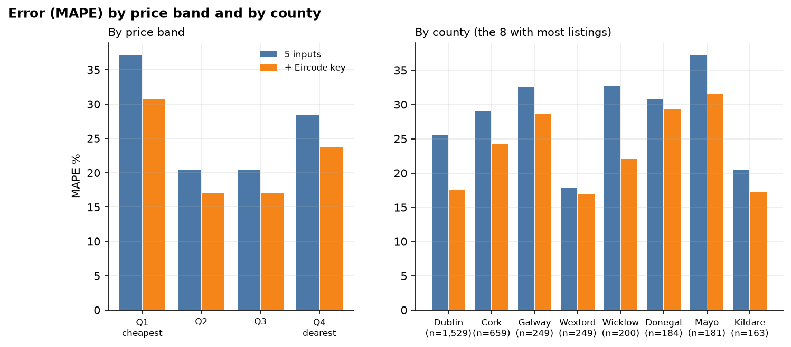
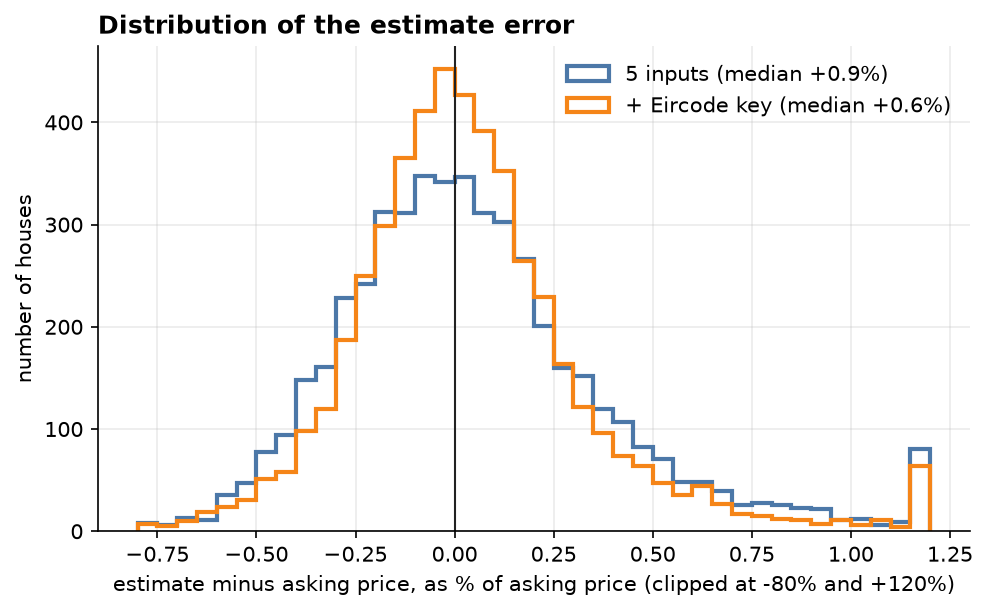

# Would extra inputs make the valuation clearly more accurate?

Development split only (4,882 rows, the same five group folds as the frozen model). Calibration and the final test were not read, and the frozen model and its final test are unchanged. The rules for what counts as worth proposing were committed before any of this ran (`experiments_config.json`).

The five-input model scores **26.72%** CV MAPE (HistGradientBoosting, the frozen model's settings) and **26.14%** (CatBoost, the second-best, as a check that a gain is not specific to one model).

## Results

Gain is the drop in CV MAPE in points (positive is better) compared with the five inputs. Folds is how many of the five folds improved.

| Added input(s) | App collects it today | HGB CV MAPE % | Gain | Folds | CatBoost CV MAPE % | Gain | Folds | Verdict |
|---|---|---|---|---|---|---|---|---|
| eircode_routing_key | yes | 22.23 | +4.49 | 5/5 | 21.78 | +4.36 | 5/5 | **proposed** |
| bathrooms | no | 26.41 | +0.31 | 5/5 | 25.81 | +0.33 | 5/5 | no |
| construction_year | no | 26.19 | +0.53 | 4/5 | 25.68 | +0.46 | 4/5 | no |
| eircode_routing_key + bathrooms | no | 21.92 | +4.80 | 5/5 | 21.67 | +4.47 | 5/5 | **proposed** |
| eircode_routing_key + bathrooms + construction_year | no | 22.06 | +4.66 | 5/5 | 21.83 | +4.31 | 5/5 | **proposed** |
| town | no | 24.80 | +1.92 | 5/5 | 23.56 | +2.58 | 5/5 | reference |
| coordinates | no | 20.17 | +6.55 | 5/5 | 19.84 | +6.30 | 5/5 | reference |
| eircode_routing_key + bathrooms + construction_year + town + coordinates | no | 19.85 | +6.87 | 5/5 | 19.53 | +6.61 | 5/5 | reference |

**Rule for proposing (fixed beforehand):** an input the app already collects needs a gain of at least 1.0 point in both models and in all five folds. A new form field needs 2.0 points. Town and coordinates are upper-bound references only.

## Pictures

All figures use out-of-fold predictions on the development split: every point is a prediction for a house the model was not trained on. Blue is the five inputs the model uses today, orange the proposed extra input.

### 1. Error for each set of inputs

5 inputs combined moves CV MAPE from 26.72% to 19.85% (HistGradientBoosting) and from 26.14% to 19.53% (CatBoost). Orange is the proposed input, blue the other app-collectable inputs, and hatched grey the reference-only ones (town and coordinates), which show how much more there is to gain.

### 2. Each of the five folds

The Eircode key lowers the error in all five folds for both models. The smallest single-fold gain is 3.82 points, so this is not one lucky fold.

### 3. How close the estimates get

Within 10% of the asking price: 27.6% to 34.5%. Within 20%: 52.0% to 60.7%. Within 30%: 69.0% to 77.7%.

### 4. Estimate versus asking price

Each patch counts houses (darker is more). The closer the cloud hugs the solid line, the better the estimate. The share within the dotted ±10% lines is in each panel title.

### 5. Price-band confusion matrix

This is the regression version of a confusion matrix: homes are split into four price bands (cut at the development quartiles €270,000, €385,000, €550,000) and each row shows where the model placed them. Right band: 60.6% to 67.4%. Right band or the one next to it: 95.8% to 97.0%.

### 6. Error by price band and county

The error is lower in 4 of 4 price bands and in 8 of the 8 biggest counties. The biggest county gain is Wicklow (32.7% to 22.0%).

### 7. Distribution of the error

The median error is +0.9% with 5 inputs and +0.6% with the Eircode key (0% means no systematic over- or under-estimate). The spread of errors (standard deviation) goes from 34 to 30 percentage points. Some very large misses remain.

## What the Eircode key does and what the rest adds

- Adding bathrooms on top of the Eircode key changes CV MAPE by -0.31 points (HistGradientBoosting) and -0.11 (CatBoost). Negative means more accurate.
- Adding bathrooms + construction_year on top of the Eircode key changes CV MAPE by -0.17 points (HistGradientBoosting) and +0.05 (CatBoost). Negative means more accurate.
- Adding bathrooms + construction_year + town + coordinates on top of the Eircode key changes CV MAPE by -2.38 points (HistGradientBoosting) and -2.25 (CatBoost). Negative means more accurate.

**A note on the rule.** The proposal rule was committed before these results, and it compares each combination with the five inputs. That let combinations containing bathrooms pass only because the Eircode key does the work, which is not what the rule was for. After seeing this, the recommendation step was changed to take the smallest set that passes (fewest new fields first). The pass or fail thresholds were not changed.

## Coverage in the data

The Eircode routing key was found for 94.8% of the development rows, bathrooms for 100.0% and the construction year for 66.7%. A missing value gets its own Unknown category (or a missing flag), so the model also works when an input is absent.

## Recommendation

**Propose adding: eircode_routing_key.** It lowers CV MAPE from 26.72% to 22.23% for HistGradientBoosting (+4.49 points) and from 26.14% to 21.78% for CatBoost (+4.36), better in every fold for both. Within 10% of the asking price goes from 27.6% to 34.5% and the average miss from €137,026 to €115,807.

A v2 model with the extra input would be a new version with its own tuning and its own final test, because nothing may change after the final test.

Gains are on development folds, so they are slightly optimistic until a v2 is scored once on the untouched final test. The data is 2024 asking prices, so these are gains in predicting asking prices.
