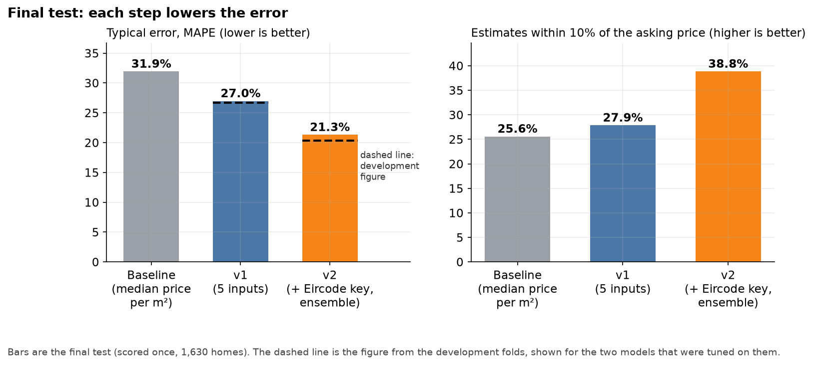
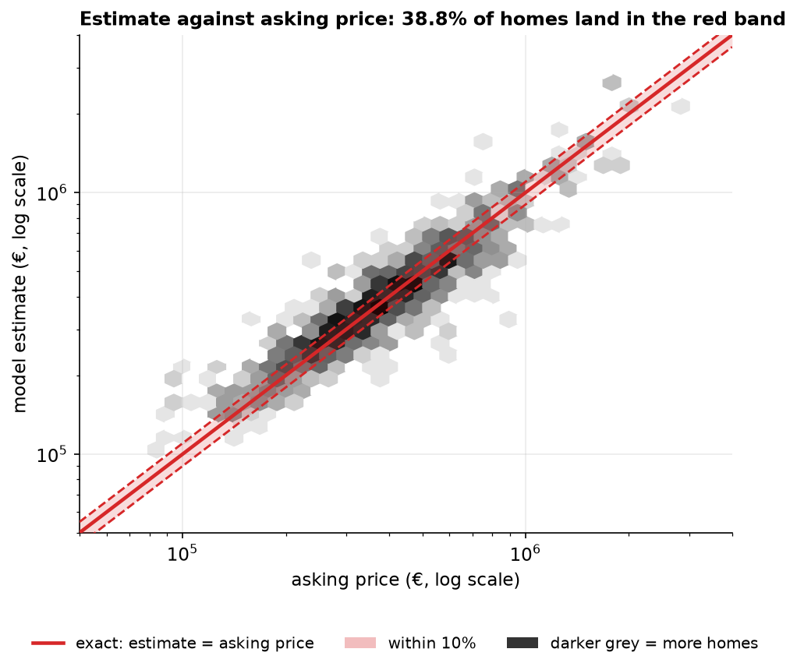
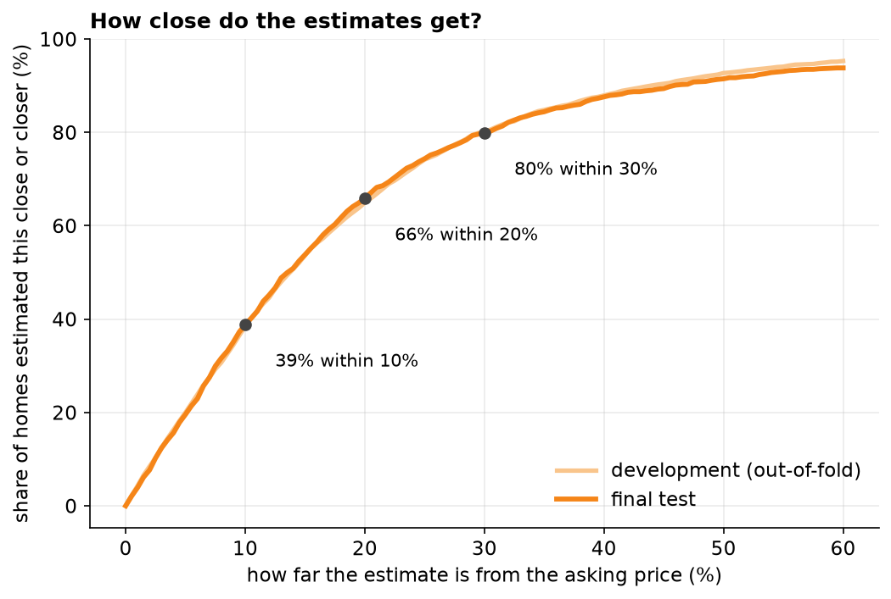
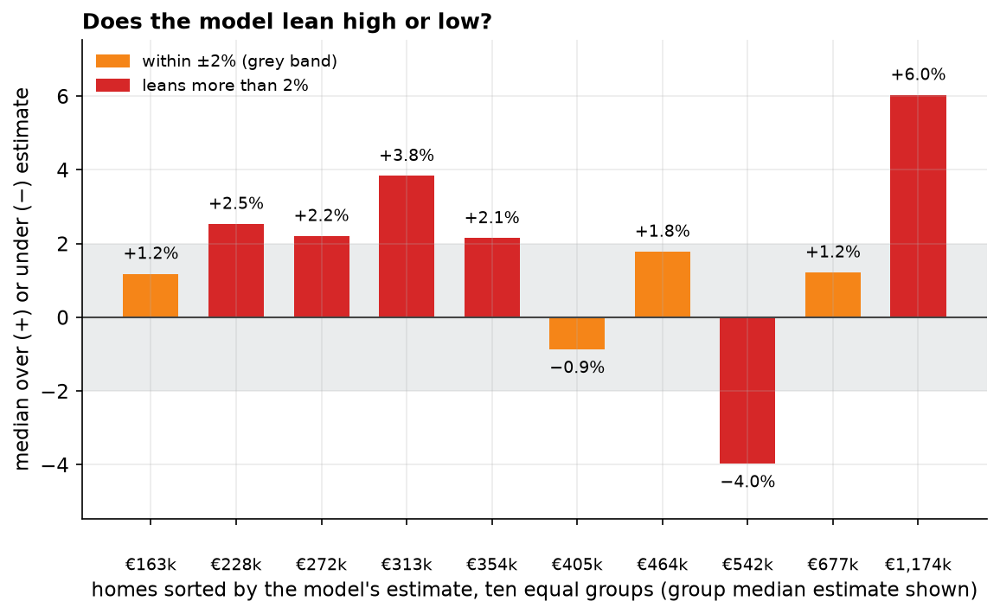
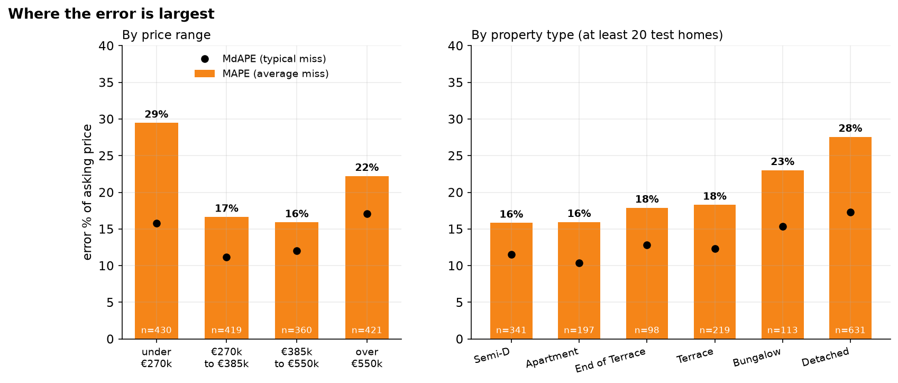
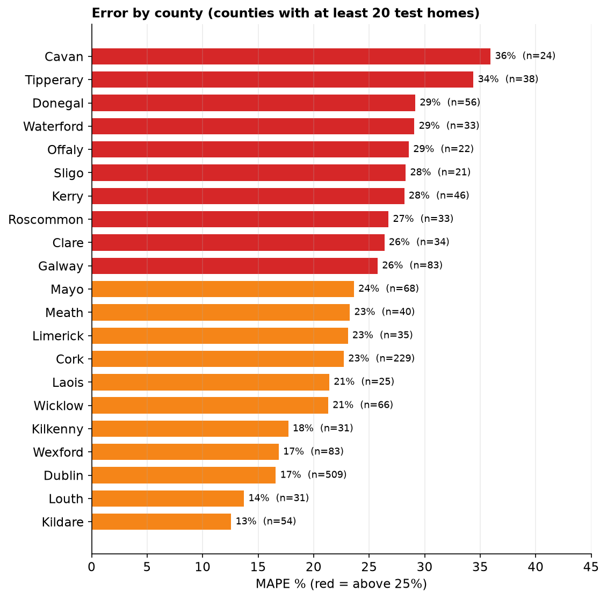
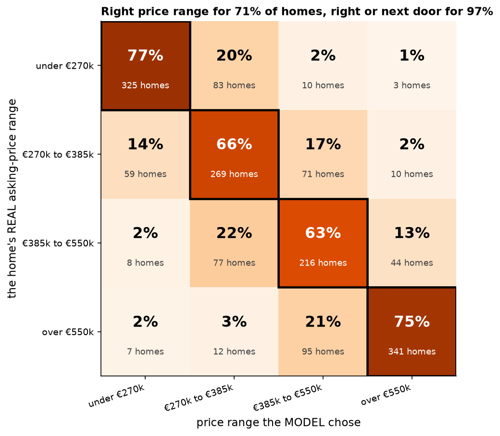
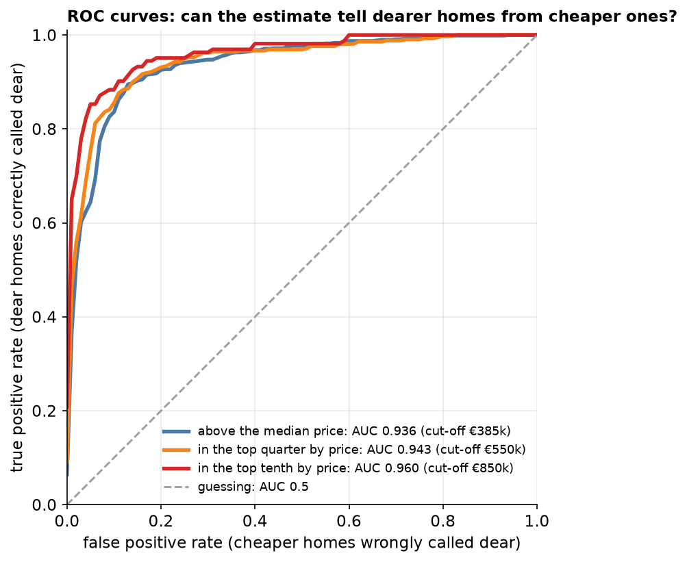
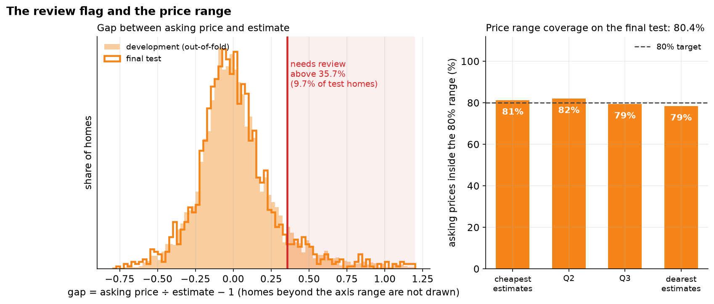

# Property valuation model v2: results report

Final test scored once on 1,630 Irish homes the model never saw. Ticket: AL-24 (the valuation model story), with the v2 work under AL-257. Model: the frozen v2 ensemble. Every rule below was written to a committed config before the number it governs was produced.

## In one paragraph

The v2 model estimates a home's 2024 asking price from the five things the app already asks for (county, floor area, bedrooms, property type, BER) plus the Eircode routing key from the address. On a final test it was scored on once, its average miss is **21.3%** of the asking price (typical miss 13.6%, about €116k on average), and 39% of estimates land within 10%. That is 5.7 points better than v1 (27.0%) and 10.6 points better than a simple price-per-m² baseline (31.9%). The development figure was 20.3%, so the test is 1.0 points above it: the development scores held up. This measures how well **asking** prices are predicted within a 2024 listing sample, nothing more.

### From baseline to v1 to v2

On the final test v2 misses by 21.3% on average against 27.0% for v1 and 31.9% for the baseline, and 38.8% of its estimates land within 10% of the asking price (v1: 27.9%).

## What the model does

| | |
|---|---|
| Task | Supervised regression: learns from Daft.ie 2024 listings, predicts the asking price of a home it has not seen |
| Inputs | County, floor area (m²), bedrooms, property type, BER (old A1–G or new A–G scale, or Unknown), and the Eircode routing key (first three characters, for example D14) |
| Output | One asking-price estimate in euro, an 80% price range around it, and a "price needs review" flag |
| How | Three models (HistGradientBoosting, CatBoost and a small neural network) each predict log price; the model averages them. Tuned with 50 random trials per model on five group folds |
| Trained on | The development and calibration rows with a floor area (6,519 homes, 80% of the split) |

## How it was tested

- The 10,081 usable listings were split 60/20/20 by *property*, so repeat adverts of one home never sit on both sides of a test.
- Models were compared and tuned on five folds inside the 60% development split only. The rules (what counts as a win, how ties break) were committed before each run.
- The calibration split trains the v2 model but never sets its threshold, because a model that has seen those homes would make the gaps look too small. The threshold and range come from out-of-fold development predictions, where every home was predicted by a model that never saw it.
- The final test was predicted once, after the threshold and range were written. A lock file stops it being scored again. All 1,630 test homes have a floor area; 384 more were unusable because the app always sends an area.

## Results on the final test

| Metric | v2 final test | v1 final test | Baseline |
|---|---|---|---|
| MAPE: average miss, % of the asking price | **21.31%** | 26.97% | 31.93% |
| MdAPE: typical (median) miss | **13.56%** | 19.19% | 21.01% |
| Within 10% of the asking price | **38.8%** | 27.9% | 25.6% |
| Within 20% / within 30% | 65.9% / 79.9% | n/a | n/a |
| MAE: average miss in euro | **€116,471** | €139,327 | €153,713 |
| RMSE: euro miss, large errors count more | €335,389 | n/a | n/a |
| R²: share of price variation explained | **0.674** | 0.624 | 0.542 |
| RMSLE: typical miss in log price | 0.293 | n/a | n/a |
| Spearman rank correlation (estimate vs asking) | 0.887 | n/a | n/a |
| Median over (+) or under (−) estimate | +1.2% | n/a | n/a |

MAPE is the ranking number: each home's miss as a share of its own asking price, averaged. The average euro miss (MAE) is dominated by dear homes, and R² of 0.67 says the model explains about two thirds of the variation in asking prices; the rest is condition, exact location and seller whim, which the inputs cannot see.

### Estimate against asking price

Each grey patch counts homes. A perfect model puts every home on the red line. The estimates follow the diagonal across the whole price range, and the spread widens for the dearest homes.

### Share of homes within X%

39% of final-test estimates are within 10% of the asking price, 66% within 20% and 80% within 30%. The development curve sits almost on top of it.

### Bias: does the model lean high or low?

4 of the 10 groups have a median lean within plus or minus 2% (grey band), and 8 of 10 lean high rather than low, so there is a small tendency to estimate above the asking price. The leans are largest at the extremes: the dearest tenth of estimates sits +6.0% from the asking price, so treat estimates in the dearest tenth (median estimate €1,174k) with extra caution.

## Where the model is weaker

### Error by price range and property type

The cheapest quarter (under €270k) has the highest percentage miss (29%), because a small euro miss is a large share of a low price. Detached is the weakest property type (28%).

### Error by county

Best: Kildare 13%, Louth 14%, Dublin 17%. Weakest: Cavan 36%, Tipperary 34%, Donegal 29%. Counties with few test homes (n shown) move more by chance, so read the large counties (Dublin, Cork) as the solid evidence.

### Price-range confusion matrix

A confusion matrix for prices: homes are split into four price ranges (cut at the development quartiles) and each row shows where the model put them. It picks the right range for 70.6% of homes and the right or the next range for 96.9%. Few homes are placed more than one range away.

## ROC and AUC

ROC curves need a yes/no question, and a price is a number, so we ask three. For each cut-off (taken from *development* prices only) the model's estimate is used as a score for "is this home's asking price above the cut-off?". The curve shows, as the score threshold moves, the share of dearer homes correctly caught (true positive rate) against the share of cheaper homes wrongly caught (false positive rate); AUC is the area under it.

### ROC curves at three price cut-offs

The estimate separates dearer from cheaper homes well at every cut-off: AUC 0.94 to 0.96 (1.0 is perfect, 0.5 is guessing). This is a ranking test, and ranking homes by price is easier than naming the price, so a high AUC sits alongside a 21% average miss.

| Question | Cut-off | Share of test homes that are "yes" | AUC |
|---|---|---|---|
| Asking price above the median price | €385k | 48% | 0.936 |
| Asking price in the top quarter by price | €550k | 26% | 0.943 |
| Asking price in the top tenth by price | €850k | 10% | 0.960 |

## "Price needs review" and the price range

The flag fires when `asking price ÷ estimate − 1` is above **35.7%**, the 90th percentile of that gap on the out-of-fold development predictions. It is a heuristic from historical asking-price gaps, not proof that a home is overpriced, and not a guaranteed 10% rate in the future. The 80% range is the same idea with a lower and an upper percentile in each of four estimate bands.

### Review flag and price range

The red line is the review threshold (35.7%), set on development data. On the final test it flags 9.7% of homes, close to the 10% it was built to flag. The 80% price range held 80.4% of asking prices, and between 79% and 82% in each price band.

| Estimate band | Estimates from | 10th to 90th percentile gap (the range) | Held asking prices (final test) | Test homes |
|---|---|---|---|---|
| cheapest quarter of estimates |  | -29% to 39% | 81.4% | 413 |
| Q2 | €273k | -22% to 29% | 82.1% | 408 |
| Q3 | €378k | -22% to 32% | 79.5% | 395 |
| dearest quarter of estimates | €539k | -29% to 44% | 78.5% | 414 |

On the final test the flag fired on 9.7% of homes (development: 10.0%) and the range held 80.4% of asking prices against its 80% target. The range is wide, a median of 68% of the estimate: that is what an honest 80% range looks like when the model's typical miss is about 14%.

## Saved model

The fitted model is one file of 1.31 MB (SHA-256 `624fb55f2d9a415689786fbb071a635bf81fceb01b0dc293c72f1c05e5810209`). It was reloaded and compared with the in-memory model on 200 fixed reference homes: maximum relative difference 0.0e+00, tolerance 1e-09. Fitting takes about 7 s and predicting 1,000 homes about 24 ms on a laptop. The shipped file is exactly the model that was evaluated: it was not refitted on any extra data after the final test.

## Limits to state next to any estimate

- **Asking prices from 2024, not sale prices.** Final sale prices can differ from asking prices, and nothing here says anything about 2027.
- **Weaker in rural counties and for the cheapest homes**, where a small euro miss is a large share of a low price. The app should say estimates may be off in some counties.
- **Some listings are odd in the data itself** (a large detached house asking €80,000, a small one asking €499,000), which no input can explain. They are in the test set on purpose.
- **The Eircode routing key is read from listing titles** for training (found for about 95% of rows); at inference it comes from the application form's required Eircode field.
- **The test is one sample of 1,630 homes.** Differences of a few tenths of a point between versions are within noise; the 5.7-point gap between v1 and v2 is far larger than that.

## Where the numbers come from

`reports/v2-final-test-results.json`, `v2-threshold.json`, `v2-tuning-results.json` and the committed rules in `ml/v2_final_config.json`. Figures are drawn by `ml/v2_report.py` from the saved predictions; nothing in this report refits or rescored the model.
