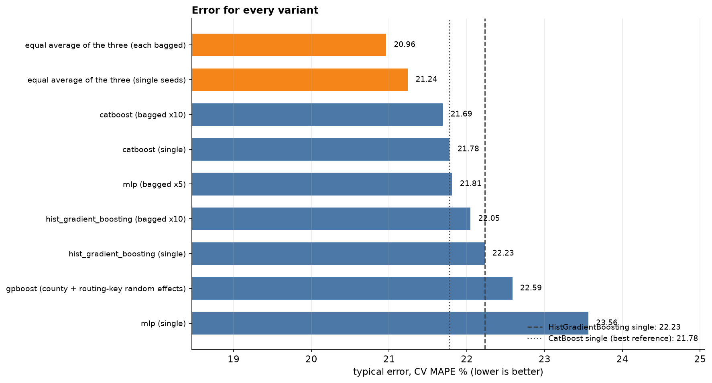

# v2 model experiments: bagging, GPBoost and TabPFN

Development split only (4,882 rows, the same five group folds), with the Eircode routing key. Calibration and the final test were not read and the frozen v1 model is unchanged. These experiments choose the v2 shortlist; the rule (committed first in `v2_models_config.json`) is at least 0.5 points better than the best single model (CatBoost), lower in all five folds, a median over or under estimate within ±2%, and within-10% not worse.

## Results

| Variant | CV MAPE % | MdAPE % | Within 10% | Average miss (MAE) | R² | Median over/under | Fit s per fold / predict ms per 1,000 | Shortlist? |
|---|---|---|---|---|---|---|---|---|
| equal average of the three (each bagged) | 20.96 | 14.06 | 37.6 | €108,904 | 0.724 | +0.5% | 42.2 / 400.1 | **yes** |
| equal average of the three (single seeds) | 21.24 | 14.58 | 38.0 | €110,143 | 0.722 | +0.8% | 4.7 / 41.8 | **yes** |
| catboost (bagged x10) | 21.69 | 14.86 | 36.1 | €112,272 | 0.691 | +0.3% | 3.9 / 49.2 | no |
| catboost (single) | 21.78 | 14.91 | 35.9 | €112,540 | 0.694 | +0.4% | 0.4 / 5.2 | reference |
| mlp (bagged x5) | 21.81 | 14.52 | 37.0 | €110,908 | 0.737 | +0.8% | 7.8 / 21.8 | no |
| hist_gradient_boosting (bagged x10) | 22.05 | 15.09 | 35.8 | €114,685 | 0.679 | +0.6% | 30.5 / 329.1 | no |
| hist_gradient_boosting (single) | 22.23 | 15.36 | 34.5 | €115,807 | 0.683 | +0.6% | 2.7 / 31.7 | reference |
| gpboost (county + routing-key random effects) | 22.59 | 15.45 | 34.2 | €117,755 | 0.654 | +1.1% | 9.1 / 4.5 | no |
| mlp (single) | 23.56 | 15.47 | 34.7 | €119,422 | 0.627 | +1.6% | 1.6 / 4.9 | reference |

## Against the rule

- **hist_gradient_boosting (bagged x10)**: gain -0.27 points vs CatBoost, lower in 2/5 folds; gain at least 0 5 FAILS, lower in all five folds FAILS, no low estimating ok, within10 not worse FAILS
- **catboost (bagged x10)**: gain +0.09 points vs CatBoost, lower in 5/5 folds; gain at least 0 5 FAILS, lower in all five folds ok, no low estimating ok, within10 not worse ok
- **mlp (bagged x5)**: gain -0.03 points vs CatBoost, lower in 2/5 folds; gain at least 0 5 FAILS, lower in all five folds FAILS, no low estimating ok, within10 not worse ok
- **gpboost (county + routing-key random effects)**: gain -0.81 points vs CatBoost, lower in 0/5 folds; gain at least 0 5 FAILS, lower in all five folds FAILS, no low estimating ok, within10 not worse FAILS
- **equal average of the three (single seeds)**: gain +0.54 points vs CatBoost, lower in 5/5 folds; gain at least 0 5 ok, lower in all five folds ok, no low estimating ok, within10 not worse ok
- **equal average of the three (each bagged)**: gain +0.82 points vs CatBoost, lower in 5/5 folds; gain at least 0 5 ok, lower in all five folds ok, no low estimating ok, within10 not worse ok

## Rare routing keys

Scored homes whose routing key had fewer than 10 rows in that fold's training data, where pooling (random effects) is claimed to help:

| Model | Homes | MAPE % |
|---|---|---|
| hist_gradient_boosting (single) | 313 | 23.97 |
| catboost (single) | 313 | 24.47 |
| gpboost (county + routing-key random effects) | 313 | 24.61 |

HistGradientBoosting is bagged by bootstrapping whole property groups because it is deterministic (a different seed gives the same model); CatBoost and the MLP are bagged by seed.

## Pictures

Blue is the best single model (CatBoost), orange the variant that came closest to the shortlist. Out-of-fold predictions on the development split throughout.

### 1. Error for every variant

equal average of the three (each bagged) has the lowest CV MAPE at 20.96%. Orange bars would be variants that pass the shortlist rule; blue ones do not. The dotted and dashed lines are the single-model references.

### 2. How close do the estimates get?

Within 10% of the asking price: 35.9% to 37.6%. Within 20%: 62.3% to 64.1%. Within 30%: 77.8% to 79.4%.

### 3. Estimate versus asking price

Each grey patch counts houses (darker is more). A perfect model would put every house on the red line, and the shaded band is within 10%. The share inside the band is in each panel title.

### 4. Did the model pick the right price range? (confusion matrix)

This is the regression version of a confusion matrix: houses are split into four price ranges (under €270k, €270k to €385k, €385k to €550k, over €550k), cut at the quartiles of the development prices, and each row shows where the model placed them. Right range: 67.8% to 69.6%. Right range or the one next to it: 97.3% to 97.3%.

### 5. Distribution of the error

The median error is +0.4% with CatBoost single and +0.5% with this variant (0% means no systematic over- or under-estimate). The spread of errors (standard deviation) goes from 30 to 29 percentage points. Some very large misses remain.
