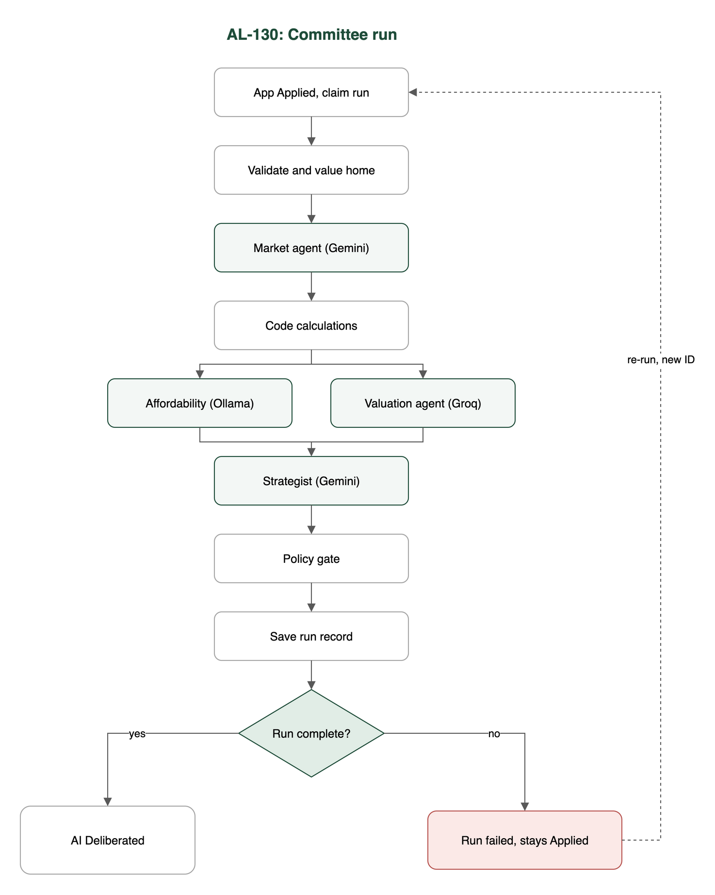

# Test case: AL-130

As an underwriter, the credit committee runs end to end on each application and saves one run record

| Item | Detail |
|---|---|
| Story | AL-130: As an underwriter, the credit committee runs end to end on each application and saves one run record |
| Epic | AL-7 AI Credit Committee |
| Owner | Nic (al-ai: the committee flow and auto-start) |
| Sprint | Sprint 2 (27 Oct to 15 Nov 2026) |
| Wireframe | wireframe.png in this folder. AL-130 has no screen, so it is a flow diagram. |
| Code | al-ai/app/committee.py, al-ai/app/auto_start.py, al-ai/app/retry_policy.py and al-ai/tests/, on main at commit 86cd8d4 |
| Tested by | Nicholas Groenewald, 9 Nov 2026 |

## What this tests

The committee runs every step in a fixed order and saves one record per run. A step that keeps failing ends the run as failed with no recommendation, and a failed run can be re-run. When an application becomes Applied the run starts by itself and a finished run moves it to AI Deliberated.

## Wireframe

## Preconditions and test data

- In `al-ai` run `uv sync` once. The saved valuation model is in `al-ai/models/valuation/`.
- No API keys needed. The tests use fake Gemini, Groq and Ollama replies and a fake ECB rate cache.
- Test data: the made-up applications in `al-ai/app/committee_samples/` (one mortgage, one HELOC).
- For TC-130-04: the Firestore emulator on port 8085, using the rules and indexes from `al-core`.

## Test cases

| ID | Acceptance criterion | Steps | Expected result | How it was checked, and the result |
|---|---|---|---|---|
| TC-130-01 | The flow runs validate, valuation model, Market & Macro, code calculations, the two agents, strategist, policy gate, then save. Each step's input and output is kept. | 1. Run the committee on the mortgage sample. 2. Look at the step order and the step results. | The steps run in that order, the two agents side by side, and every step has a result. | Automated: `tests/test_committee.py`: `test_the_nodes_run_in_the_ticket_order_with_the_two_agents_side_by_side`, `test_the_run_state_holds_every_steps_result`, `test_each_agent_calls_the_provider_agents_json_gives_it`, `test_the_strategist_is_given_both_agents_reports`. **Pass.** |
| TC-130-02 | The local runner, given a made-up application, saves one run record with a run ID, every step's result, both recommendations and a link to every logged call. | 1. Run the committee with fakes and check the record. 2. Run the local runner with a rates file. | One record per run with a new run ID, every step, both recommendations and one call ID per logged call. | Automated: `tests/test_committee.py`: `test_a_run_saves_one_record_with_a_unique_run_id_and_the_fields_from_the_ticket`, `test_the_record_lists_a_call_id_for_every_logged_attempt`, `test_the_record_can_be_written_as_json_and_kept_in_a_file`; `tests/test_committee_rates.py`: `test_the_local_runner_takes_its_rates_from_a_cache_file_and_never_asks_the_ecb`; `tests/test_committee_ids.py`. The live run is manual and I didn't run it for this test (see Notes). **Pass.** |
| TC-130-03 | If a required step still fails after its retries, the run is saved as failed with the step and reason and no recommendation. A re-run gets a new run ID linked to the failed one. | 1. Make a fake provider keep failing. 2. Re-run the failed record. | The run is saved as failed with the step and reason and no recommendation. The re-run has a new run ID that points back to the failed run. | Automated: `tests/test_committee.py`: `test_a_step_that_fails_after_its_retries_saves_a_failed_run_with_no_recommendation`, `test_a_reply_the_strategist_cannot_use_fails_the_run_after_its_retry`, `test_an_error_nobody_planned_for_still_saves_a_failed_record`, `test_when_both_side_by_side_agents_fail_the_earlier_step_in_the_flow_is_the_one_reported`; `tests/test_retry_budget.py`: `test_a_provider_error_is_retried_at_most_twice_after_2_then_8_seconds`, `test_when_the_budget_runs_out_mid_run_the_run_is_saved_as_failed_with_the_evidence_so_far_and_no_recommendation`, `test_a_re_run_has_a_new_run_id_linked_to_the_failed_run_and_leaves_the_failed_record_alone`, `test_only_a_failed_run_can_be_re_run`; `tests/test_budget_before_first_call.py`. **Pass.** |
| TC-130-04 | When an application moves to Applied the committee starts in the background. The AI run status is kept apart from the application status, and a complete run moves the application to AI Deliberated. | 1. On the emulator, set an application to Applied with the listener running. 2. Finish one run as complete and one as failed. | One run starts. The AI run status is its own field. A complete run moves the application to AI Deliberated and a failed one leaves it at Applied. | Automated (emulator): `tests/test_auto_start.py`: `test_claiming_an_applied_application_marks_it_running_and_writes_the_base_run_document`, `test_two_claims_at_the_same_moment_have_exactly_one_winner`, `test_a_complete_run_moves_the_application_to_ai_deliberated_with_a_status_history_entry`, `test_a_failed_run_leaves_the_application_applied_with_no_history_entry_and_the_reason_on_the_run`, `test_the_listener_starts_a_run_when_an_application_becomes_applied_and_only_one`, `test_the_listener_picks_up_an_application_that_was_submitted_while_it_was_not_running`; `tests/test_auto_start_wiring.py`. **Pass.** |
| TC-130-05 | Every LLM call, Serper search and valuation-model call is saved as one record in an `ai_calls` collection that underwriters can read (brokers only for their own clients). | Can't be tested on this build. | One `ai_calls` document per call. | No test on `main`. **Not met yet.** It depends on PR #177, which isn't merged. |

## Test run

From `al-ai` on `main` at `86cd8d4`, 9 Nov 2026, Apple M5 Pro:

- `uv run --quiet pytest -q -p no:cacheprovider tests/test_committee.py tests/test_retry_budget.py tests/test_committee_ids.py tests/test_budget_before_first_call.py tests/test_committee_rates.py tests/test_auto_start.py tests/test_auto_start_wiring.py`: **62 passed, 33 skipped.** All 33 skips are in `tests/test_auto_start.py`, which needs the emulator.
- With the Firestore emulator on port 8085: `npx -y firebase-tools emulators:exec --only firestore --project demo-al --config firebase.json "cd al-ai && uv run --quiet pytest -q -p no:cacheprovider tests/test_auto_start.py tests/test_auto_start_wiring.py"`: **38 passed, 0 skipped.**

Neither run called a real model, Serper or the ECB.

## Notes

- TC-130-02: I didn't do a live run because it calls Gemini, Groq, Ollama and Serper. The live evidence is the two run records from 4 Nov 2026 in `al-ai/docs/committee-evidence/` (mortgage: Approve to Approve; HELOC: Approve to Conditionally Approve). To run it: `cd al-ai && uv run python -m app.committee app/committee_samples/mortgage-application.json`.
- TC-130-02: the runner test swaps `run_committee` for a fake, so it checks the runner's setup, not a full run.
- TC-130-02: the "link" to each call is a call ID in the record. The `ai_calls` documents it points to only exist once PR #177 is merged.
- TC-130-03: `rerun()` works in the tests, but nothing in the app calls it yet. We haven't decided what triggers a re-run. The local runner can re-run with `--rerun <failed run id>`.
- TC-130-04: the listener only starts when the service runs with `AUTO_START_COMMITTEE=true`. It's off by default.
- TC-130-05: PR #177 (Dumi's) is still open. On `main` every call already carries the run, application and broker IDs, but nothing writes the `ai_calls` collection yet.
