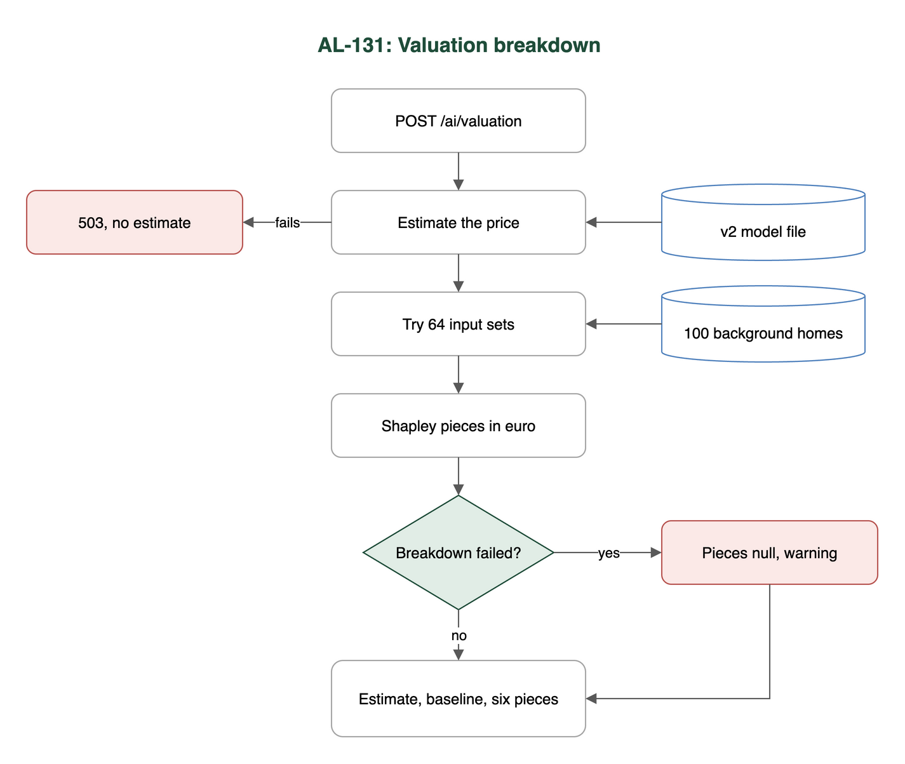

# Test case: AL-131

As a data scientist, the valuation endpoint returns how much each house feature added to or took off the estimate

| Item | Detail |
|---|---|
| Story | AL-131: As a data scientist, the valuation endpoint returns how much each house feature added to or took off the estimate |
| Epic | AL-14 Explain the valuation |
| Owner | Nic (al-ai: the valuation breakdown) |
| Sprint | Sprint 2 (27 Oct to 15 Nov 2026) |
| Wireframe | wireframe.png in this folder. AL-131 has no screen, so it is a flow diagram. |
| Code | al-ai/app/valuation_explain.py, al-ai/app/valuation_endpoint.py, al-ai/models/valuation/ (model, background sample, model card) and al-ai/tests/, on main at commit 86cd8d4 |
| Tested by | Nicholas Groenewald, 9 Nov 2026 |

## What this tests

Every valuation now comes back with a baseline and one euro piece for each of the six inputs. The tests check the pieces are exact Shapley values, that they add up to the estimate, that the breakdown is fast enough and that the model card explains how to read it.

## Wireframe

## Preconditions and test data

- In `al-ai` run `uv sync` once. No network or keys needed.
- The saved model in `al-ai/models/valuation/`: `valuation-v2.joblib`, `manifest.json`, `background-sample.csv` (the 100 background homes), `reference-breakdown.json` and `MODEL_CARD.md`.
- The tests use made-up homes kept in the test files.
- For TC-131-02 only: the raw dataset at `al-ai/data/raw/daft_housing_data.csv` (not in git) and `AL_FULL_TEST_SPLIT=1`.

## Test cases

| ID | Acceptance criterion | Steps | Expected result | How it was checked, and the result |
|---|---|---|---|---|
| TC-131-01 | Each estimate also returns a baseline (the average estimate over a fixed sample of training homes) and one euro piece for each of the six inputs: county, floor area, bedrooms, property type, BER and Eircode area. | 1. Send a home to `/ai/valuation`. 2. Read `baseline_eur` and `contributions`. | A baseline that's the same for every home, and six pieces, biggest first. Only the routing key shows, never the full Eircode. | Automated: `tests/test_valuation_breakdown.py`: `test_the_response_has_a_baseline_and_one_piece_for_each_of_the_six_inputs`, `test_the_baseline_is_the_same_for_every_home`, `test_each_piece_shows_the_input_it_explains`, `test_the_pieces_are_sorted_by_size_biggest_first`, `test_the_full_eircode_never_appears_in_the_breakdown`, `test_an_eircode_area_the_model_has_not_seen_still_gets_a_piece`; `tests/test_valuation_explain.py`: `test_the_background_sample_is_saved_with_the_model_and_in_the_model_card`. **Pass.** |
| TC-131-02 | For every home in the final test split, the baseline plus the pieces equals the estimate to within EUR 1 (checked by a test). | 1. Run the full-split test with `AL_FULL_TEST_SPLIT=1`. | The biggest gap over all 1,630 test homes is under EUR 1. | Automated: `tests/test_valuation_explain.py`: `test_contributions_add_up_to_the_estimate_for_every_property_in_the_final_test_split` (1 passed, 9 min 21 s); also on fixed homes: `test_the_saved_model_contributions_add_up_to_the_estimate_within_one_euro`, `tests/test_valuation_breakdown.py`: `test_baseline_plus_the_pieces_equals_the_estimate_within_one_euro`. **Pass.** |
| TC-131-03 | The pieces are exact Shapley values worked out on the euro estimate. | 1. Run the Shapley code on toy models where I can work the answer out by hand. 2. Run it on the saved model. | Toy answers match by hand, an ignored input gets exactly 0 and the pieces add up to the model's euro answer. The endpoint matches the saved reference breakdown. | Automated: `tests/test_valuation_explain.py`: `test_a_linear_model_gives_each_input_its_own_step_away_from_the_background_average`, `test_two_inputs_that_interact_share_the_credit_equally`, `test_an_input_the_model_ignores_gets_exactly_zero`, `test_baseline_plus_contributions_is_the_model_answer_for_the_home`, `test_many_homes_at_once_match_one_at_a_time`, `test_more_than_ten_inputs_are_refused_because_the_count_doubles_with_each_one`, `test_contributions_come_back_one_per_input_not_one_per_encoded_column`; `tests/test_valuation_breakdown.py`: `test_the_response_matches_the_breakdown_saved_with_the_model`. **Pass.** |
| TC-131-04 | Adding the breakdown adds no more than 500 ms to a `/valuation` call on a team laptop. | 1. Load the model and warm it up. 2. Time the estimate alone and the breakdown, 15 calls each. | The breakdown adds under 500 ms. | Timed by hand (no automated test): breakdown median 204 ms, worst 224 ms; estimate alone median 18 ms. Apple M5 Pro, 9 Nov 2026. Matches the model card (median 196 ms, worst 230 ms, 27 Oct 2026). **Pass.** |
| TC-131-05 | The model card explains how to read the numbers: how far each input moved this estimate from the average, not what changing the house would do. | 1. Read "How to read the breakdown" in `al-ai/models/valuation/MODEL_CARD.md`. | The card explains the baseline, says each piece is how far that input moved this estimate, and says it isn't a what-if. | Read by hand. The card explains the baseline and says each piece is "how much that input moved the estimate away from the baseline for this home". It never says outright that a piece isn't what changing the house would do. **Partly met.** The "not a what-if" half is missing. |

## Test run

From `al-ai` on `main` at `86cd8d4`, 9 Nov 2026, Apple M5 Pro:

- `uv run --quiet pytest -q -rs -p no:cacheprovider tests/test_valuation_explain.py tests/test_valuation_breakdown.py tests/test_valuation_breakdown_failure.py tests/test_docker_image_files.py`: **53 passed, 1 skipped.** The skip is the full-split test, which only runs with `AL_FULL_TEST_SPLIT=1`.
- `AL_FULL_TEST_SPLIT=1 uv run --quiet pytest -q -rs -p no:cacheprovider "tests/test_valuation_explain.py::test_contributions_add_up_to_the_estimate_for_every_property_in_the_final_test_split"`: **1 passed** in 9 min 21 s.

## Notes

- TC-131-02: on a fresh clone the full-split test skips, because the raw dataset isn't in git. This laptop has it.
- TC-131-04: my first timing run was slower (median 276 ms, worst 332 ms) because the 9-minute full-split test was running at the same time. Still under 500 ms. The numbers above are from a second run on its own.
- TC-131-04: I timed the two functions directly, not a full HTTP call, so it measures what the breakdown adds and not the network.
- TC-131-05: one extra sentence in the model card, saying a piece isn't what changing the house (like adding a bedroom) would do, would fully meet this.
- `tests/test_docker_image_files.py` is in the run because PR #123 put the background sample in the Docker image. It checks every file the service reads at run time is in the image.
- If the breakdown fails, the estimate still comes back with both fields null and a warning (`tests/test_valuation_breakdown_failure.py`).
