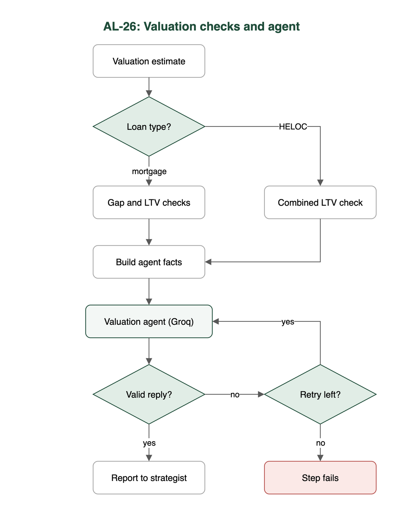

# Test case: AL-26

As an underwriter, a valuation agent flags overvalued collateral and computes LTV

| Item | Detail |
|---|---|
| Story | AL-26: As an underwriter, a valuation agent flags overvalued collateral and computes LTV |
| Epic | AL-7 AI Credit Committee |
| Owner | Nic (al-ai: the valuation checks and the valuation agent) |
| Sprint | Sprint 2 (27 Oct to 15 Nov 2026) |
| Wireframe | `wireframe.png` in this folder. AL-26 has no screen, so it is a flow diagram. |
| Code | `al-ai/app/valuation_checks.py`, `al-ai/app/valuation_agent.py`, `al-ai/app/prompts/valuation_agent_v2.md` and `al-ai/app/llm/agents.json`, on `main` at commit `d1d1014` |
| Tested | 13 Nov 2026, Nicholas Groenewald |

## What this tests

Code works out the price gap, the "price needs review" flag and both LTVs, so these numbers never come from the LLM. The agent only explains the results and gives a recommendation. These tests check the maths, the edge cases, and that the agent's reply is checked before it is used.

## Wireframe

## Preconditions and test data

- The `al-ai` dependencies are installed with `uv` (`cd al-ai && uv sync`). The saved valuation model is in `al-ai/models`.
- The automated tests need no API keys and no network, because the agent step runs against a fake network.
- `AL_LIVE_LLM` is not set, so the live test skips.
- A live run (criteria 4 and 5) would need a Groq key in `al-ai/.env` as `GROQ_API_KEY`. None was made for this test case.

## Test cases

| ID | Acceptance criterion | Steps | Expected result | Result and evidence |
|---|---|---|---|---|
| TC-26-01 | Code works out the signed gap (asking price / estimate - 1) and flags the price for review when the gap is above the threshold. Exactly at the threshold does not count. | 1. Call `check_valuation` with the gap exactly at the threshold. 2. Call it again with the gap just above. | `needs_review` is false at the threshold and true just above it. | Pass. `test_valuation_checks.py`: `test_a_gap_exactly_at_the_threshold_does_not_trigger_review`, `test_a_gap_just_above_the_threshold_triggers_review`. `test_valuation_shared_gap.py` checks the same through the endpoint. |
| TC-26-02 | Code works out purchase LTV and model LTV and checks each against the 90% limit. | 1. Call `check_valuation` with a loan at exactly 90% and just over. 2. Try an asking price above and below the estimate. | Purchase LTV is loan / asking price. Model LTV is loan / the lower of asking price and estimate. Both are fine at 90% and over the limit just above it. | Pass. `test_valuation_checks.py`: `test_purchase_price_ltv_is_loan_over_asking_price`, `test_model_ltv_uses_the_lower_of_asking_price_and_estimate`, `test_an_ltv_just_above_90_percent_is_over_the_limit`. |
| TC-26-03 | Tests cover a gap at the threshold, an asking price below the estimate, LTV at exactly 90% and a low-support warning. | 1. Run the tests for the four named cases. | No flag at the threshold. A lower asking price gives a negative gap and no flag. 90% is within the limit. The warning reaches the agent unchanged. | Pass. `test_valuation_checks.py`: `test_an_asking_price_below_the_estimate_is_never_flagged`, `test_an_ltv_of_exactly_90_percent_is_within_the_limit`, `test_support_warnings_are_passed_through_unchanged`, plus the threshold test from TC-26-01. |
| TC-26-04 | The agent on Mistral (Groq as the backup, switched by hand) returns JSON that passes the schema check: rating, recommendation, concerns and suggested conditions. | 1. Give the agent step the facts from `build_facts`. 2. Feed it fake good and bad replies. | Only a reply with `rating`, `recommendation` (Approve, Conditionally Approve or Decline), `conditions` and `explanation` passes. A bad reply gets one retry, then the step fails. Approve is refused when the price is flagged or an LTV is over the limit. The model only comes from `agents.json`. | Not met as worded (Notes 1 and 2). The tests pass: `test_a_good_reply_passes`, `test_a_reply_with_the_wrong_fields_is_rejected`, `test_a_reply_cannot_recommend_approve_when_the_code_says_the_price_needs_review`, `test_two_bad_replies_in_a_row_fail_the_step_with_the_reason_and_no_other_model_is_used`. The code uses a different model and different reply fields from the criterion. No live run. |
| TC-26-05 | The report calls the model figure "indicative" and never a verified valuation. | 1. Read the prompt rule. 2. Read the saved real runs in `al-ai/docs/valuation-agent-runs.json`. | The report says the figure is indicative and never calls it a verified valuation. | Partly met (Note 3). The wording is a rule in the prompt, and no automated test checks it. |

## Test run

From `al-ai` on `main` at `d1d1014`, 13 Nov 2026:

`uv run pytest -q -p no:cacheprovider tests/test_valuation_checks.py tests/test_valuation_shared_gap.py tests/test_valuation_agent.py tests/test_llm_config.py tests/test_groq_decision_recorded.py`

Result: 132 passed, 1 skipped. The skipped test is `test_live_the_configured_valuation_agent_answers_a_made_up_application`. It only runs with `AL_LIVE_LLM=1` because it makes a real Groq call, and I made no live model call for this test case.

## Notes

1. The criterion says Mistral, with Groq as the backup. The code runs the agent on Groq `openai/gpt-oss-120b`, with Gemini `gemini-3.1-flash-lite` as the manual backup (`al-ai/app/llm/agents.json`). We dropped Mistral on 28 Oct because it has no free API tier. The team agreed this in `#announcements`, and it is recorded in `docs/infrastructure.md` (PR #124). The "switched by hand, never automatically" part still holds: the backup is only used when a person edits `agents.json`.
2. The criterion asks for a rating of fair, slightly high or needs review, and a list of concerns. The code differs in three ways. `rating` is `strong`, `adequate`, `weak` or `unsupported`, and it rates the collateral, not the price. There is a `conditions` list and a free-text `explanation`, but no separate `concerns` field. The price judgement is the code's `price_needs_review` flag, which the agent can't clear. Conditions such as an independent surveyor's valuation are allowed, and they appear in all three saved real runs.
3. The prompt (`al-ai/app/prompts/valuation_agent_v2.md`) tells the model the estimate "is an indicative estimate and not a surveyor's valuation", and the three saved real runs (Groq, Gemini, Ollama) all say so. But `check_reply` doesn't require the word or reject "verified valuation", so a reply that left it out would still pass.
4. The HELOC path (combined LTV against 80%) is part of the same step and is tested in `test_valuation_agent.py`, but it is outside this story's criteria.
