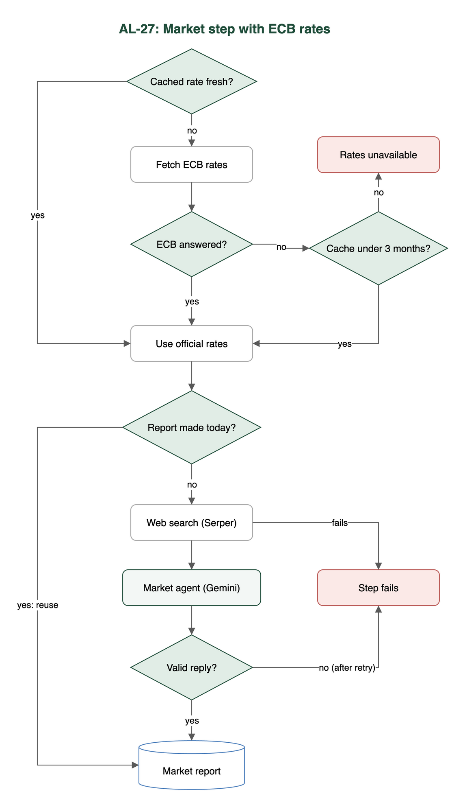

# Test case: AL-27

As an underwriter, a market research agent pulls current central bank rates and mortgage trends

| Item | Detail |
|---|---|
| Story | AL-27: As an underwriter, a market research agent pulls current central bank rates and mortgage trends |
| Epic | AL-7 AI Credit Committee |
| Owner | Nic (al-ai: the market agent and the rate wiring). Dumi wrote the ECB rate tool (`rates.py`) and the `ai_calls` logging. |
| Sprint | Sprint 2 (27 Oct to 15 Nov 2026) |
| Wireframe | `wireframe.png` in this folder. AL-27 has no screen, so it is a flow diagram. |
| Code | `al-ai/app/rates.py`, `al-ai/app/market_agent.py`, `al-ai/app/serper.py`, `al-ai/app/committee.py` and `al-ai/app/prompts/market_agent_v1.md`, on `main` at commit `d1d1014` |
| Tested | 13 Nov 2026, Nicholas Groenewald |

## What this tests

Code gets two rates from the ECB and caches them, and the run stops if it has no rate it can trust. The market agent then searches the web with Serper and writes a short outlook on Gemini, and the code checks that outlook before it is kept. These tests check the rates, the stop rules, the agent's reply, report reuse and logging.

## Wireframe

## Preconditions and test data

- The `al-ai` dependencies are installed with `uv` (`cd al-ai && uv sync`).
- The automated tests use a fake ECB, a fake Serper, a fake Gemini and a fake Firestore, so they need no keys and no network.
- `AL_LIVE_LLM` is not set, so the live tests skip. The Firestore emulator is not running, so its 5 tests skip.
- A live run (criterion 3 by hand) needs `GEMINI_API_KEY` and `SERPER_API_KEY` in `.env`. I made no live calls.

## Test cases

| ID | Acceptance criterion | Steps | Expected result | Result and evidence |
|---|---|---|---|---|
| TC-27-01 | A code tool fetches the ECB main refinancing rate and the Irish benchmark mortgage rate, now and 12 months earlier, with dates, and caches them in Firestore. | 1. Ask for each rate with a fake ECB. 2. Ask again within a day. | Each rate has its value, date, the value 12 months earlier and the time it was fetched. The second call reads the cache and does not ask the ECB. | Pass. `test_rates.py`: `test_the_mortgage_rate_is_the_latest_month_with_the_month_a_year_earlier`, `test_the_refinancing_rate_is_the_latest_change_and_the_rate_in_force_a_year_earlier`, `test_a_rate_fetched_less_than_a_day_ago_comes_from_the_cache_without_asking_the_ecb`, `test_the_firestore_cache_keeps_one_document_per_rate_in_rates_cache`. |
| TC-27-02 | If the official data can't be fetched or the latest observation is more than 3 months old, the run fails with that reason. No rate is made up or taken from LLM text. | 1. Make the ECB unreachable and run the committee with an empty cache. 2. Run it with a cached rate that is too old. | The run is saved as failed at the market step, the reason names the rate and no model is called. | Partly met (Note 1). The tests pass: `test_a_missing_rate_with_the_ecb_down_stops_the_run_naming_the_rate_and_calls_no_model`, `test_a_rate_older_than_three_months_with_the_ecb_down_stops_the_run`, `test_the_cutoff_is_three_calendar_months`, `test_no_stand_in_rate_or_sample_figures_file_is_left_in_the_live_path`. They only cover the case where the ECB is down. |
| TC-27-03 | The agent on Gemini uses Serper search and returns JSON that passes the schema check: outlook, a short summary and dated source links. It gets no borrower data and has no vote. | 1. Run the agent step with a fake search and fake model replies. 2. Feed it good and bad replies. | Only a reply with `outlook`, `summary` and 1 to 5 dated `sources` passes. The prompt holds the official figures and search results and nothing about a borrower. | Pass. `test_market_agent.py`: `test_a_good_reply_passes`, `test_a_reply_with_the_wrong_fields_is_rejected`, `test_the_model_is_sent_the_data_and_no_borrower_details`, `test_the_agent_is_the_one_agents_json_names_for_market`. `test_strategist_agent.py`: `test_the_agents_that_disagree_are_worked_out_by_code`. The saved real run in `al-ai/docs/market-agent-runs.json` (28 Oct) is the live evidence. No new live run. |
| TC-27-04 | The LLM report is reused within the same day unless the official figures change, and each run records the ID of the report it used. | 1. Run the market step twice on the same day with the same figures, through the listener's setup. 2. Run it again with a changed rate, and on a new day. | The second run calls no search or model and records `reused_report_id`. A changed rate or a new day makes a new report. Every run keeps `steps.market.report_id`. | Pass, with a limit (Note 2). `test_market_agent.py`: `test_the_same_day_and_the_same_figures_reuse_the_report_and_call_nothing`. `test_market_report_shared.py`: `test_a_second_run_on_the_same_day_reuses_the_first_runs_report_and_calls_neither_gemini_nor_serper`, `test_a_run_after_the_official_figures_change_makes_a_new_report`. |
| TC-27-05 | Every Serper search and LLM call is logged with its query or prompt version, results, timing and outcome. | 1. Run a whole committee run with a fake call sink. 2. Make a search fail. | There is one `ai_calls` document per search and per model attempt, including failed ones, and no key is saved. | Pass. `test_call_log.py`: `test_a_model_attempt_document_holds_everything_the_ticket_lists`, `test_a_new_market_report_saves_each_search_and_the_model_call_and_a_later_run_links_to_them`, `test_a_search_that_fails_is_saved_with_its_error`. The Firestore emulator tests were skipped. |

## Test run

From `al-ai` on `main` at `d1d1014`, 13 Nov 2026:

`uv run pytest -q -p no:cacheprovider tests/test_rates.py tests/test_committee_rates.py tests/test_market_agent.py tests/test_serper.py tests/test_strategist_agent.py tests/test_committee.py tests/test_market_report_shared.py tests/test_call_log.py tests/test_call_log_firestore.py`

Result: 222 passed, 7 skipped. Two skipped tests are live ones that need `AL_LIVE_LLM=1` and real keys. The other five are the Firestore emulator tests in `test_call_log_firestore.py`.

## Notes

1. The criterion says the run fails when the latest observation is more than 3 months old. `rates.get_rate` only applies a 3 month limit when the ECB can't be reached and it falls back to the cache. If the ECB answers with an old value, the rate is accepted. I checked this on 13 Nov with a fake ECB reply whose latest month was 2026-05: `get_rate("mortgage_ie")` returned 3.9 from 2026-05 with no error. No test covers it. The mortgage series usually lags a month or two, so it could matter. An old main refinancing observation is normal, since it only changes now and then, so PR #180 judges that rate on when we last fetched it.
2. Reports are kept in `MemoryReportStore`. The listener now shares one store across all its runs (PR #202), so reuse works while it keeps running. A restart starts with an empty store, and the local runner makes its own each time. The recorded runs in `al-ai/docs/committee-evidence/` are from 4 Nov, before PR #202, so `reused_report_id` is null in both.
