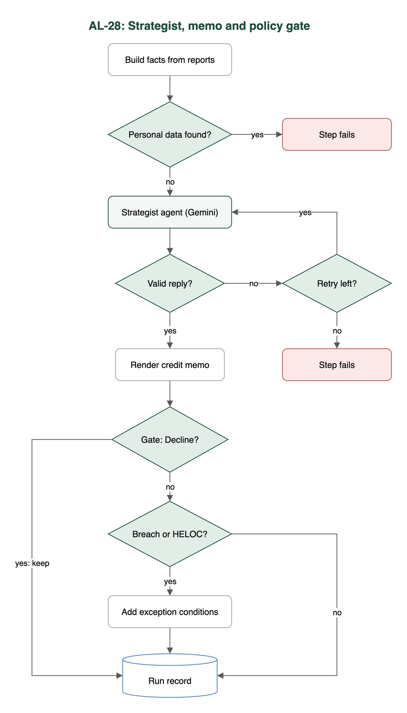

# Test case: AL-28

As an underwriter, a strategist agent decides Approve / Conditionally Approve / Decline and writes a credit memo

| Item | Detail |
|---|---|
| Story | AL-28: As an underwriter, a strategist agent decides Approve / Conditionally Approve / Decline and writes a credit memo |
| Epic | AL-7 AI Credit Committee |
| Owner | Nic (al-ai: the strategist agent and the policy gate) |
| Sprint | Sprint 2 (27 Oct to 15 Nov 2026) |
| Wireframe | `wireframe.png` in this folder. AL-28 has no screen, so it is a flow diagram. |
| Code | `al-ai/app/strategist_agent.py`, `al-ai/app/policy_gate.py`, `al-ai/app/committee.py`, `al-ai/app/reasoning_trail.py` and `al-ai/app/prompts/strategist_agent_v1.md`, on `main` at commit `d1d1014` |
| Tested | 13 Nov 2026, Nicholas Groenewald |

## What this tests

The strategist reads the other agents' reports and a loan summary, then writes a recommendation and a credit memo. After it, a policy gate in code adds a condition for every Central Bank limit breach, and an Approve with a breach becomes Conditionally Approve. These tests check the reply, the disagreement rule, the gate and what is saved.

## Wireframe

## Preconditions and test data

- The `al-ai` dependencies are installed with `uv` (`cd al-ai && uv sync`).
- The automated tests need no API keys and no network, because the strategist and the committee run against a fake network.
- `AL_LIVE_LLM` is not set, so the live test skips.
- The tests that write to Firestore need the Firestore emulator. I did not start it, so those skipped (see Test run).
- A live run needs a Gemini key in `al-ai/.env` as `GEMINI_API_KEY`. I made none for this test case.

## Test cases

| ID | Acceptance criterion | Steps | Expected result | Result and evidence |
|---|---|---|---|---|
| TC-28-01 | Given the three reports and a loan summary with no name or contact details, the agent on Gemini returns JSON that passes the schema check: recommendation, conditions and a memo under the fixed headings. | 1. Build the facts from the three reports and a loan summary. 2. Try an extra loan field and a report holding an email or phone number. 3. Feed fake good and bad replies. | Only the chosen loan fields are allowed, and a personal identifier stops the step before the prompt is built. A reply passes only with `recommendation`, `conditions` and a `memo` with exactly the six sections. The model comes from `agents.json`. | Pass. `test_strategist_agent.py`: `test_a_loan_summary_with_any_field_we_did_not_choose_is_refused`, `test_a_personal_identifier_inside_a_report_is_refused_before_it_reaches_the_prompt`, `test_a_good_reply_passes`, `test_the_memo_is_written_out_with_the_headings_from_the_ticket_in_order`. No live run. |
| TC-28-02 | When the voting agents disagree, the Disagreements section names who disagreed and why the strategist sided as it did. | 1. Give facts where the affordability and valuation votes differ. 2. Feed a fake reply whose Disagreements section does not name both agents. | Code sets `voting_agents_disagree`. A reply that does not name the Affordability and Valuation agents is rejected, retried once, then the step fails. | Partly met (Note 1). Naming who disagreed passes: `test_the_agents_that_disagree_are_worked_out_by_code`, `test_when_the_voting_agents_disagree_the_disagreements_section_names_both`, `test_a_reply_that_hides_a_disagreement_is_retried_then_fails`. "Why it sided" is only a prompt rule. |
| TC-28-03 | A code gate runs after the agent. Every breach adds a "requires lender exception review" condition, Approve becomes Conditionally Approve and Decline stays Decline. | 1. Call `apply_policy_gate` with Approve and a breach, Conditionally Approve and a breach, and no breach. 2. Run a committee with a mortgage over the 90% LTV limit. | Each breach adds "Requires lender exception review (RULE)". Approve becomes Conditionally Approve. Conditionally Approve keeps its conditions plus the new one. Decline stays Decline. No breach changes nothing. | Pass. `test_policy_gate.py`: `test_approve_with_a_breach_becomes_conditionally_approve_with_the_exception_condition`, `test_conditionally_approve_with_a_breach_keeps_its_conditions_and_adds_the_new_one`, `test_approve_with_no_breach_is_left_alone`, `test_decline_with_a_breach_stays_decline_and_the_breach_is_recorded`. `test_committee.py` runs the over-limit mortgage. |
| TC-28-04 | The original and the effective recommendation are both saved, with the rule that changed it. | 1. Run the committee. 2. Read the saved run record. 3. Read the fields the reasoning trail builds for the `ai_runs` document. | The record has `original_recommendation`, `effective_recommendation` and `steps.policy_gate` with the `breaches` (rule IDs) and `changed`. The trail copies both recommendations onto the run. | Pass for the run record and the trail. `test_committee.py`: `test_a_run_saves_one_record_with_a_unique_run_id_and_the_fields_from_the_ticket`. `test_reasoning_trail.py`: `test_the_original_and_effective_recommendations_come_from_the_policy_gate`, `test_a_policy_gate_downgrade_shows_as_a_different_effective_recommendation`. The tests that write to Firestore need the emulator and skipped (Note 2). |
| TC-28-05 | The result is labelled a recommendation, and the underwriter's sign-off in the portal is the lending decision. | 1. Read the prompt and the record field names. 2. Read the portal code for the loan file. | The result is called a recommendation, and the portal separates it from the underwriter's sign-off. | Met on reading the code (Note 3). I did not open the portal or run its tests. |

## Test run

From `al-ai` on `main` at `d1d1014`, 13 Nov 2026:

`uv run pytest -q -p no:cacheprovider tests/test_strategist_agent.py tests/test_policy_gate.py tests/test_committee.py tests/test_reasoning_trail.py`

Result: 125 passed, 1 skipped. The skipped test is `test_live_the_configured_strategist_writes_a_checked_memo`. It only runs with `AL_LIVE_LLM=1` because it makes a real Gemini call.

I also ran `tests/test_auto_start.py`, which has the tests for saving to Firestore. All 62 skipped because they need the Firestore emulator, so I can't claim they passed.

## Notes

1. `check_reply` only checks that the Disagreements section names both agents when they disagree. The "say which one you side with and why" part is in the prompt (`al-ai/app/prompts/strategist_agent_v1.md`). The saved real run in `al-ai/docs/strategist-agent-runs.json` (Gemini `gemini-3.1-flash-lite`) does it: "I side with the Valuation agent because the model LTV of 95.0% exceeds the 90% limit". I did not repeat that run.
2. When the committee finishes, `auto_start.finish` writes the credit memo, both recommendations and the policy gate result to the `ai_runs` document (PR #197 and PR #200, both mine, merged 12 Nov). It also writes the gate result to `review/underwriting`. That code is on `main`, but the tests that check the writes need the emulator, so I did not run them here.
3. The portal's loan file shows a Recommendation block with the original and effective recommendation, the credit memo and the policy gate. It says "Final authority stays with the human underwriter" (`CommitteeConsole.tsx`, Nikoloz, PR #195, merged 12 Nov). The sign-off panel (`SignOffPanel.tsx`) records the decision, and only an underwriter sees it.
4. The rule IDs are `LTI_CAP`, `LTV_CAP` and `CLTV_CAP`, so a condition reads, for example, "Requires lender exception review (LTV_CAP)". A HELOC also always gets "Requires an independent surveyor's valuation (HELOC)". That alone turns an Approve into Conditionally Approve. It is policy, not a breach.
