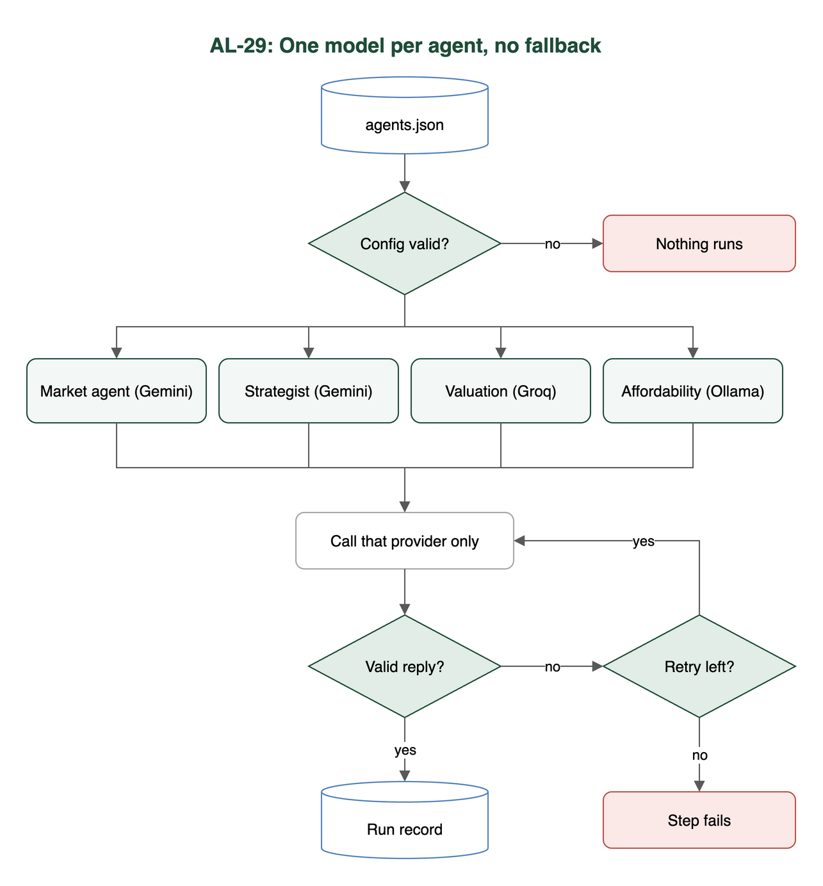

# Test case: AL-29

As a developer, the agents run on two cloud LLM APIs plus a local Ollama model

| Item | Detail |
|---|---|
| Story | AL-29: As a developer, the agents run on two cloud LLM APIs plus a local Ollama model |
| Epic | AL-7 AI Credit Committee |
| Owner | Nic (al-ai: the provider clients and the model config) |
| Sprint | Sprint 2 (27 Oct to 15 Nov 2026) |
| Wireframe | `wireframe.png` in this folder. AL-29 has no screen, so it is a flow diagram. |
| Code | `al-ai/app/llm/agents.json`, `al-ai/app/llm/config.py`, `al-ai/app/llm/clients.py` and `al-ai/app/llm/smoke.py`, on `main` at commit `d1d1014` |
| Tested | 13 Nov 2026, Nicholas Groenewald |

## What this tests

One config file pins each agent to an exact model, and there is one small client per provider. Nothing switches model on its own. These tests check the config, the smoke test, a saved committee run on three models, and that a dead Ollama makes the step fail instead of falling back to a cloud model.

## Wireframe

## Preconditions and test data

- The `al-ai` dependencies are installed with `uv` (`cd al-ai && uv sync`).
- The automated tests use a fake network for every provider, so they need no keys and no Ollama.
- `AL_LIVE_LLM` is not set, so the four live tests skip.
- A live run needs `GEMINI_API_KEY` and `GROQ_API_KEY` in the repo-root `.env`, and `ollama serve` running with `qwen3.5:9b` pulled. I made no live calls for this test case. Criteria 2 and 3 use evidence saved in the repo.

## Test cases

| ID | Acceptance criterion | Steps | Expected result | Result and evidence |
|---|---|---|---|---|
| TC-29-01 | One config maps each agent to a provider and an exact pinned model: Market & Macro and Strategist on Gemini, Valuation on Mistral Small 4 (Groq as the backup, switched by hand), Affordability on Ollama. | 1. Open `al-ai/app/llm/agents.json`. 2. Run the config tests. | Market & Macro and Strategist: `gemini-3.1-flash-lite`. Valuation: Groq `openai/gpt-oss-120b`, with a manual backup of Gemini `gemini-3.1-flash-lite`. Affordability: Ollama `qwen3.5:9b`. No moving aliases. | Not met as worded (Note 1). The tests pass: `test_the_real_config_loads_and_pins_a_model_for_every_agent`, `test_no_model_in_the_real_config_is_a_moving_alias`, `test_the_valuation_agent_runs_on_groq_and_its_manual_backup_is_gemini_flash_lite`, in `test_llm_config.py`. Valuation is on Groq, not Mistral. |
| TC-29-02 | A schema smoke test passes for each provider before the committee uses it, and the exact Gemini and Ollama model IDs go into `docs/infrastructure.md`. | 1. Live and manual, not run here: `cd al-ai && uv run python -m app.llm.smoke`. 2. Read `al-ai/docs/llm-smoke-results.json`. 3. Read the "Smoke test (27 Oct 2026)" entry in `docs/infrastructure.md`. | Each provider in use answers the tiny structured request with `{"answer": 4}`. | Partly met (Note 2). The tests pass: `test_a_working_provider_is_recorded_as_passed_with_its_details`, `test_a_wrong_answer_is_a_fail_even_if_the_schema_passes`, `test_the_saved_evidence_never_contains_a_key`, in `test_llm_smoke.py`. `llm-smoke-results.json` shows a pass on 27 Oct 2026 for Gemini, Ollama and Groq, and `infrastructure.md` records the IDs. I did not re-run the live smoke test. |
| TC-29-03 | One end-to-end committee run's log shows real calls to Gemini, Mistral and Ollama, each with its exact model ID, and the three voting agents use three different models. | 1. Live and manual, not run here: `cd al-ai && uv run python -m app.committee app/committee_samples/mortgage-application.json`. 2. Read `al-ai/docs/committee-evidence/mortgage-run.json`. | The record from 4 Nov 2026 shows `market` and `strategist` on Gemini, `valuation_agent` on Groq and `affordability` on Ollama, each with its model ID and outcome `ok`. | Not met as worded (Note 3). The test passes: `test_each_agent_calls_the_provider_agents_json_gives_it` in `test_committee.py`. The saved record shows Gemini, Groq and Ollama, so three different models for the three voting agents, but no Mistral call. I did not re-run it live. |
| TC-29-04 | On a machine that can't run Ollama, the affordability step fails instead of quietly using a cloud model. | 1. Point `OLLAMA_HOST` at a dead address with the cloud keys set. 2. Run the committee. | The affordability step fails after its retries, and every retry goes to Ollama. The run is saved as failed. Nothing goes to Gemini or Groq. | Pass. `test_an_unreachable_ollama_fails_the_affordability_step_and_no_cloud_model_is_called`, `test_a_committee_run_with_ollama_down_is_saved_as_failed_and_the_affordability_prompt_goes_nowhere_else`, in `test_ollama_no_fallback.py`. `test_llm_clients.py` also checks that a rate limit is an error with no fallback. |

## Test run

From `al-ai` on `main` at `d1d1014`, 13 Nov 2026:

`uv run pytest -q -p no:cacheprovider tests/test_llm_config.py tests/test_llm_clients.py tests/test_llm_smoke.py tests/test_ollama_no_fallback.py tests/test_groq_decision_recorded.py tests/test_committee.py`

Result: 122 passed, 4 skipped. The four skipped are `test_live_provider_answers_the_tiny_structured_request` in `test_llm_smoke.py`, one per provider. They only run with `AL_LIVE_LLM=1` and real keys, and I made no live calls for this test case.

## Notes

1. Criteria 1 and 3 name Mistral Small 4. On 28 Oct 2026 the team agreed to run the valuation agent on Groq `openai/gpt-oss-120b` instead, because Mistral has no free API tier. It is recorded in `docs/infrastructure.md`. The manual backup is Gemini `gemini-3.1-flash-lite`, used only when someone edits `agents.json`. Mistral is still a supported provider in `clients.py`, but the config does not name it. So the two cloud APIs are Gemini and Groq.
2. The criterion says "before the committee uses it". The smoke test is a script a person runs. The committee does not run it or check its result. The recorded pass is from 27 Oct 2026, before the first committee run on 4 Nov.
3. The criterion says the run's "log" shows real calls. The evidence is the saved run record, where each step lists its attempts with provider, model, prompt version and outcome. The model in each attempt is the one the config asked for. The provider's own reply does not save its model name separately. In `heloc-run.json`, the market and strategist steps each had one `provider_error` and the valuation agent one `invalid_reply` before they worked on retry, all on the same model.
