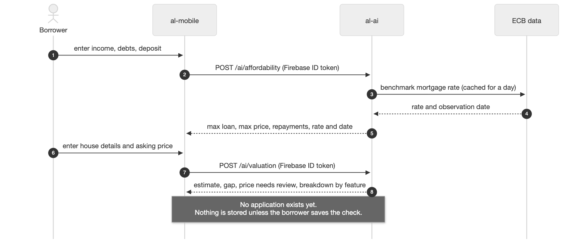

# Use case: AL-6 Fair-Price Property Checker

*A borrower or underwriter gets a fair-price estimate for a home from its details, so they can tell whether the asking price is reasonable.*

| Item | Detail |
|---|---|
| Epic | AL-6 Fair-Price Property Checker |
| Feature (from the brief) | Mobile: Fair-Price Property Checker (county, m2, bedrooms, property type, BER). Web: Loan File & Collateral Assessment (asking price vs ML valuation). AI: Automated Property Valuation Model. |
| Owner | Nic owns the valuation model (al-ai). The checker screen is Ibrahima's (iOS, AL-22) and the loan-file comparison is Nikoloz's (portal, AL-23). |
| Sprints | In Sprint 1 (8 to 25 Oct 2026) the valuation model was trained, tested and saved, and its model card was written (AL-24). In Sprint 2 it was served from an endpoint, and the checker screen and the loan-file comparison were built on top of it. |
| Wireframes | Week 3 borrower app prototype, section "Property price checker", pages 23 to 35 (docs/week 3 report/Borrower app prototype.pdf). The checker screen also asks for the Eircode (decided on 23 Oct, on AL-22), which the Week 3 screens do not show. |

## Goal

As a borrower or underwriter, I want a fair-price estimate for a property from its details, so that I can tell whether the asking price is reasonable.

## Actors

- Borrower: signed in to the iOS app, with the home they want to buy on their application.
- Underwriter: signed in to the portal, reviewing a loan file.
- al-ai (the AI API): serves the saved valuation model (`POST /ai/valuation`).
- Valuation model (v2): the average of three models trained on the Daft.ie 2024 listings.
- Data scientist (Nic): trains and tests the model and reports how accurate it is.

## Preconditions

- The user is signed in (Firebase Auth) and every request carries their Firebase ID token.
- al-ai is running behind the gateway.
- The saved model file matches its recorded SHA-256 checksum. If it doesn't, it is not loaded.
- The home's details are filled in: county, floor area, bedrooms, property type, BER and Eircode.

## Trigger

The borrower opens the property price check, or the underwriter opens a loan file.

## Main flow

1. The user enters the home's details on the checker screen: county, floor area (m2), bedrooms, property type, BER and the full Eircode. The Eircode is required and is checked with the same rule as the application form (for example A65 F4E2). The checker screen is part of Sprint 2. In Sprint 1 the same details, Eircode included, were collected on the "The home you're buying" step of the application form.
2. The app or portal sends the details to al-ai with the user's Firebase ID token. The loan file sends the Eircode stored on the application. al-ai takes the first three characters of the Eircode, the routing key, because that is the part the model uses.
3. al-ai checks the model file's SHA-256, loads the saved model and values the home.
4. al-ai returns the estimate, an 80% price range and a "price needs review" flag.
5. The borrower sees the estimate next to their asking price. The underwriter sees the same estimate next to the asking price in the loan file.
6. The check stores nothing.

## Alternative flows

**A. Older BER scale.** Old BER subgrades (A1 to E3) are first converted to their band (A to G). A BER value we don't recognise is treated as Unknown.

**B. Unfamiliar routing key.** If the Eircode is valid but the model has not seen its routing key, the key is treated as Other and the estimate is still given. A missing routing key is treated as Unknown. The app always sends an Eircode, so Unknown only happens when another caller leaves it out.

**C. Asking price far above the estimate.** When the asking price is more than 35.7% above the estimate, the "price needs review" flag shows for the underwriter.

## Exceptions

These belong to the Sprint 2 endpoint. Sprint 1 built and tested the model and its loader.

- Empty or invalid Eircode: the app shows an error under the field ("Enter an Eircode like A65 F4E2") and sends nothing.
- Floor area outside 15 to 1,000 m2, unknown county or unsupported property type: al-ai refuses the request and names the field. Nothing is estimated.
- Signed out or token expired: the user is asked to sign in again.
- No connection, or a server error: the app says it couldn't calculate the estimate and offers Try again.
- The model file does not match its SHA-256: al-ai refuses to load it.

## Postconditions

- Success: the user has an estimate, a price range and a review flag. Nothing is saved.
- Failure: no estimate is shown, and the user can try again.

## Business rules

- The estimate is based on 2024 asking prices of similar Irish homes. It is not a sale price or a valuation report, and it says nothing about later years.
- The model uses five inputs plus the Eircode routing key: county, floor area, bedrooms, property type, BER and the routing key. Nothing else.
- Accuracy on the final test, scored once on 1,630 homes: estimates are on average 21.31% off the asking price, and 38.8% of them land within 10% of it. The first model (v1, five inputs) was 26.97% off.
- The 80% price range contained 80.4% of the asking prices in the final test.
- The "price needs review" flag marks asking prices more than 35.7% above the estimate. It is a rule of thumb from past listings, not proof that a home is overpriced.
- The estimate is worked out in al-ai, never in the app, so the app and the portal show the same number for the same home.
- The app sends the full Eircode and al-ai works out the routing key from it, so that rule lives in one place.
- Out of scope: sale prices, valuation reports, and explaining each estimate (a separate epic).

## Flow diagram

The affordability check and the valuation (docs/diagrams/02-flow-affordability-valuation.png). The valuation part is Sprint 2.

## Stories in this epic

| Story | What | Owner | Sprint | Status on 13 Nov |
|---|---|---|---|---|
| AL-22 | Enter property details (county, size, bedrooms, type, BER) and get a fair valuation | Ibrahima | Sprint 2 | Done |
| AL-23 | Compare the seller's asking price against the model's valuation (portal loan file) | Nikoloz | Sprint 2 | In Review |
| AL-24 | Train a property valuation model and report how accurate it is | Nic | Sprint 1 | Done: model trained, tested once, saved with a model card |

## Notes

- Model work for AL-24: AL-117 data readiness, AL-118 benchmark, AL-119 tuning, AL-120 threshold and final test, AL-121 saved model and model card. The v2 model came from AL-255 and AL-257.
- The model card is `al-ai/models/valuation/MODEL_CARD.md`. The full numbers, graphs and tables are on the Model support page in Confluence.
