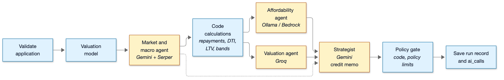
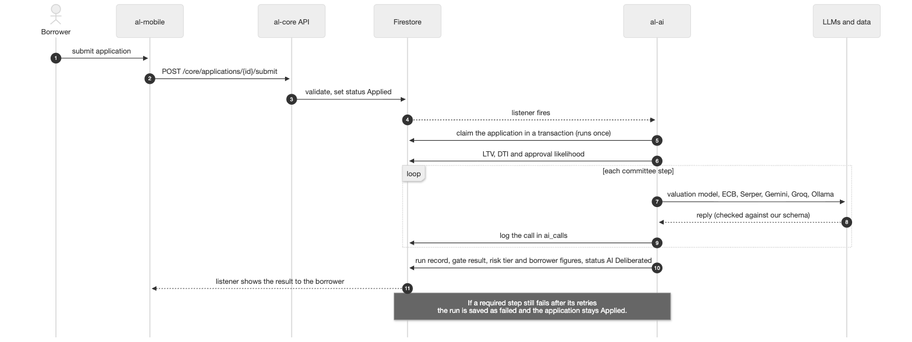

# Use case: AL-7 AI Credit Committee (Sprint 2 update)

Every submitted application is reviewed by a committee of AI agents, and the underwriter can read their reasoning. This update shows the committee as it runs on `main` at the end of Sprint 2.

| Item | Detail |
|---|---|
| Epic | AL-7 AI Credit Committee |
| Feature (from the brief) | AI: Agentic AI Architecture (the four agents); Model Diversity & Local Inference. Web: AL-AI Audit & Deliberation Console. Mobile: AL-AI Interface (LTV, DTI, approval likelihood). |
| Owner | Nic owns the agents, the committee run and the borrower's figures (al-ai). The reasoning screen is Nikoloz's (portal, AL-30). The borrower's figures screen is Ibrahima's (iOS, AL-31). The AI call log was Dumi's (AL-140). |
| Sprints | Sprint 1 (8 to 25 Oct 2026) built the affordability agent (AL-25). Sprint 2 (27 Oct to 15 Nov 2026) built the other three agents, the providers, the policy gate, the full committee run and its auto-start. |
| Wireframes | Week 3 prototypes in `docs/week 3 report/`: the portal's underwriter loan file review (pages 25 to 40) and the borrower app's application status (pages 42 to 47). The agent stories have no screen, so each story folder in `nic/` has a flow diagram instead. |

## Goal

As an underwriter, I want every application reviewed by a committee of AI agents with their reasoning visible, so that I start my decision from a full, explained assessment.

## Actors

The borrower submits the application on the iOS app, which starts the run, and later sees their indicative LTV, DTI and approval likelihood (AL-31). The broker is on every application through its `brokerId`, and every run and AI call is recorded against it. An application with no broker isn't run. The underwriter reads the reasoning, the credit memo and the recommendation in the portal (AL-30) and makes the decision.

Inside al-ai, a Firestore listener (switched on with `AUTO_START_COMMITTEE=true`) watches for Applied applications, claims each one and runs the committee in the background, two at a time. Firestore holds the application, its status and the `ai_runs` and `ai_calls` documents. The two official rates come from the ECB data portal.

The agents and their models are pinned in `al-ai/app/llm/agents.json`:

| Agent | Provider | Model |
|---|---|---|
| Market and macro | Gemini (cloud), with Serper web search | `gemini-3.1-flash-lite` |
| Affordability | Ollama (local) | `qwen3.5:9b` |
| Valuation | Groq (cloud) | `openai/gpt-oss-120b` (backup, switched by hand: Gemini `gemini-3.1-flash-lite`) |
| Strategist | Gemini (cloud) | `gemini-3.1-flash-lite` |

## Preconditions

- The application is Applied, has a broker, has never had an AI run (`aiRunStatus` is empty) and has a county, property type and BER that the valuation model knows.
- al-ai is running with the listener on, the saved valuation model loaded, the Gemini, Groq and Serper keys set and Ollama reachable.
- The ECB rates can be fetched, either from the ECB or from a cache that isn't too old.

## Trigger

The borrower's submit moves the application to Applied. The listener sees it and claims it in a Firestore transaction, so two listeners or two events only start one run. Applications already Applied when al-ai starts are picked up too.

## Main flow

1. Claim. In one transaction the listener sets `aiRunStatus = running` and `aiRunId` on the application and creates `ai_runs/{runId}`. It also writes the borrower's indicative figures: DTI at the benchmark rate, purchase LTV against the asking price and the approval likelihood. The submit has already returned, so the run happens in the background.
2. Validate. A missing broker, or a county, property type or BER the model doesn't know, stops the run here, before any model call.
3. Valuation model. The saved model values the home and returns its estimate, breakdown and any low-support warnings.
4. Market and macro. Code loads the two ECB rates. The market agent gets those and a few Serper search results (no borrower data) and replies with an outlook (rising, stable or falling), a short summary and its sources. The listener shares one report store across its runs, so the report is reused for the rest of the day unless the rates change (AL-307).
5. Code calculations. Code works out every figure the agents will quote and every limit the gate will check: repayments, the stressed repayment at the benchmark rate plus 2 points, DTI, surplus, the price gap, the "price needs review" flag, both LTVs and the policy breaches.
6. Affordability and valuation agents, side by side. The first explains the affordability figures. The second explains whether the price is in line and how sure the estimate is. Each gives a recommendation, and each reply is checked against a schema and the figures it was given.
7. Strategist. It gets the two reports, the market view and a loan summary with no name or contact details, plus a note from code on whether the two agents disagree. It replies with Approve, Conditionally Approve or Decline, its conditions and a credit memo under six fixed headings: Application summary, Affordability, Property assessment, Market context, Disagreements, and Recommendation and conditions.
8. Policy gate. Code applies the limits to the strategist's recommendation (see Business rules). Both the original and the effective recommendation are kept.
9. Save. The run record holds every step's output and the provider, model, prompt version and attempts of each AI call. (The local runner saves this record as a JSON file instead.) One transaction then writes:
    - to `ai_runs`: status complete, each agent's report and vote, the credit memo, the recommendations, the consensus and the policy gate result (AL-62, AL-305);
    - to `review/underwriting`: the policy gate result, the risk tier and the LTV band (AL-305, AL-301);
    - to the application: `aiRunStatus = complete`, the move to AI Deliberated with a `statusHistory` entry (actor committee), the borrower's figures recalculated with the run's rate and valuation, and for a mortgage its LTV percentage against the model's estimate (AL-63, AL-304);
    - to `ai_calls`: one document for every model attempt, every Serper search, the valuation model's call and any reused market report, with the id `{runId}-{step}-{attempt}` (AL-140).
10. The underwriter reads the reasoning and memo in the portal and decides. The borrower sees the indicative figures in the app.

## Alternative flows

A HELOC uses the HELOC rules (valuation prompt v2). The gate checks the combined LTV (what is owed plus the new line) against the model's estimate, and every HELOC gets the condition "Requires an independent surveyor's valuation (HELOC)". On submit the approval likelihood is Unknown because there's no valuation yet. When the run completes, the borrower gets the combined LTV and a label.

A failed run can be run again as a new run linked to it (`rerunOf`). The failed record is left as it is, and only the application's latest run can be re-run. Today that works from the local runner (`python -m app.committee <application> --rerun <run id>`). The listener never restarts a failed run by itself, so an outage can't cause a loop, and nothing in the portal starts a re-run yet.

The same flow runs with no Firestore through `cd al-ai && uv run python -m app.committee <application.json>`, which saves the run record as a JSON file. The two real runs from 4 Nov are in `al-ai/docs/committee-evidence/`.

If Groq is down or rate-limited, a person changes the valuation agent's model in `agents.json` to the Gemini backup. The code never switches by itself, so the log always shows the model that really answered.

On AWS (planned, AL-129) the affordability agent will run on Qwen3 32B on Amazon Bedrock instead of Ollama. That isn't built yet.

## Exceptions

- An invalid application or a missing broker fails the run at validate, with the reason.
- With no ECB rate, no borrower figures are written on claim, and the run fails at the market step and names the missing rate. If the search fails, the market step fails and says why. Nothing is made up.
- A reply that breaks the schema, quotes a figure it wasn't given, tries to clear a flag the code set or (market agent) links a page that wasn't in the search results is retried once, with the reason shown. If the retry is rejected too, the step fails.
- A provider timeout, outage or rate limit is retried up to twice, after 2 s and then 8 s, or after the provider's Retry-After if that's longer. A missing key fails straight away. No other provider is used instead.
- Each call gets 60 s and the whole run gets 5 minutes. When time runs out, the step stops and the run fails with that reason.
- When a step fails, the steps after it are skipped and the run is saved as failed. The failed step and reason go on the `ai_runs` document, never on the application, because the borrower can read the application. The application gets `aiRunStatus = failed` and stays at Applied, the borrower's figures from submit stay, and there's no recommendation. A crash outside the steps is recorded the same way (failed step `run`), so an application is never left stuck on running.
- If an application is claimed twice, the second claim loses the transaction and starts nothing. A late write from a run that is no longer the latest can't change the application's status.

## Postconditions

On success there is one completed `ai_runs` document, the application is at AI Deliberated with a history entry, the borrower's figures are recalculated from the run, and the risk tier and policy gate result are saved on `review/underwriting`. On failure the run is marked failed with its step and reason, the application stays at Applied and no agent has decided anything.

## Business rules

- Code owns the numbers: repayments, DTI, LTV, the bands, the price gap and the policy breaches. An agent explains and recommends, and it can never change a figure or clear a flag.
- The policy gate is code and runs after the strategist. For a purchase, the loan can be up to 4 times income for a first-time buyer and 3.5 times otherwise, and up to 90% of the asking price. The LTV limit uses the asking price, never our estimate, because the estimate isn't a legal valuation. For a HELOC, what is owed plus the new line can be up to 3.5 times income and up to 80% of the home's estimated value. Exactly on a limit is fine.
- Each breach adds the condition "Requires lender exception review" with its rule ID. An Approve that has to carry any condition becomes Conditionally Approve. A Decline stays a Decline with no conditions. A breach never makes a recommendation more favourable.
- The borrower's LTV, DTI and approval likelihood are indicative, not verified. The approval likelihood is Unknown, Low, Medium or High, never a percentage, and it is separate from the committee's recommendation.
- The steps run in a fixed order under LangGraph. No agent chooses the route.
- Two cloud APIs (Gemini and Groq) and one local model (Ollama) are used. Model IDs are pinned, never "latest", and there is no automatic fallback.
- No name, email address, phone number or full Eircode reaches a prompt. Gemini and Groq run on free keys, so only made-up data goes through them.
- The committee advises. The underwriter decides.

## Flow diagrams

The committee pipeline (`docs/diagrams/05-committee-pipeline.png`):

The submit and the automatic start (`docs/diagrams/03-flow-submit-ai-review.png`):

## Stories in this epic

| Story | What | Owner | Sprint | Status on 13 Nov |
|---|---|---|---|---|
| AL-25 | Affordability agent reports disposable surplus, stress-tested repayments and DTI | Nic | 1 | Done |
| AL-26 | Valuation agent flags overvalued collateral and computes LTV | Nic | 2 | Done |
| AL-27 | Market research agent pulls current central bank rates and mortgage trends | Nic | 2 | Done |
| AL-28 | Strategist decides Approve, Conditionally Approve or Decline and writes a credit memo | Nic | 2 | Done |
| AL-29 | The agents run on two cloud LLM APIs plus a local Ollama model | Nic | 2 | Done |
| AL-130 | The committee runs end to end on each application and saves one run record | Nic | 2 | Done |
| AL-30 | Underwriter reads each agent's reasoning trail and the committee's consensus | Nikoloz | 2 | In Progress |
| AL-31 | Borrower sees their estimated LTV, DTI and approval likelihood | Ibrahima | 2 | In Progress (backend AL-63 is Done) |

Sprint 2 subtasks: AL-122 to AL-128, AL-138, AL-139, AL-141, AL-201, AL-246, AL-290, AL-291, AL-63, AL-62, AL-140 (Dumi), AL-124 (Dumi), AL-301, AL-304, AL-305 and AL-307.

## Changes since Sprint 1

- The valuation agent runs on Groq `openai/gpt-oss-120b`, not Mistral. Mistral has no free API tier, so the team agreed to drop it on 28 Oct. The hand-switched backup is now Gemini, not Groq.
- The market step now runs before the code calculations, because they use the ECB rates it loads. The affordability and valuation agents then run side by side, and the strategist waits for both.
- Rates come from the ECB: the Irish new mortgage rate (the benchmark) and the ECB main refinancing rate. They're cached in Firestore for a day, and a rate older than 3 months is refused. No rate is ever guessed.
- Retries are what the Exceptions section describes. Sprint 1 planned one schema retry and then a failure.
- A failed run is still saved, with its failed step and reason.
- Sprint 1 said an underwriter would start a re-run with `POST /ai/committee/runs`. That endpoint doesn't exist. The re-run is built in code, but nothing in the app calls it, because we haven't decided what should trigger one.
- The committee also handles HELOC applications (AL-201), and each run now saves the reasoning, policy gate result, risk tier and AI calls that Sprint 1 only planned.

## Still to do

The affordability agent on Bedrock for the AWS deployment (AL-129, To Do, Nic). A way to start a re-run from the app (not ticketed, the trigger isn't decided). The reasoning screen (AL-30) and the borrower figures screen (AL-31), both In Progress.

Model decisions and the smoke test that passed on 27 Oct are in `docs/infrastructure.md`. Test cases are in `test-case.pdf` in each story folder in `nic/`.
